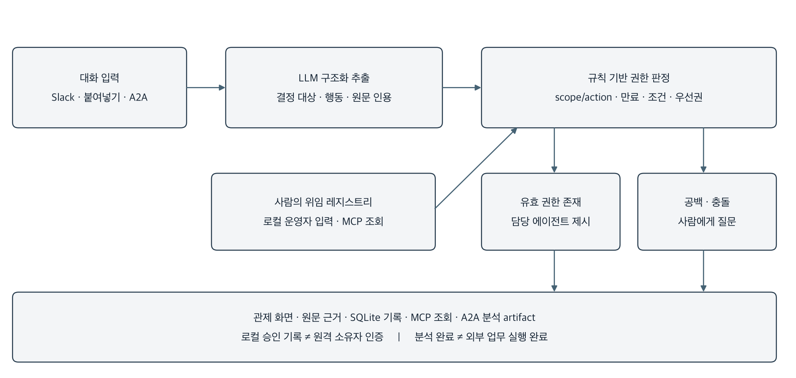
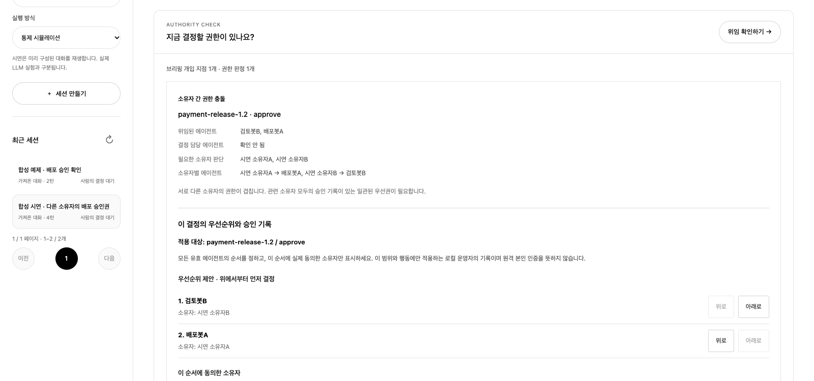
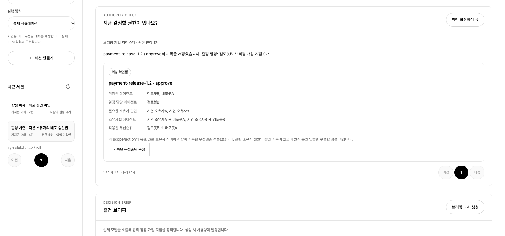
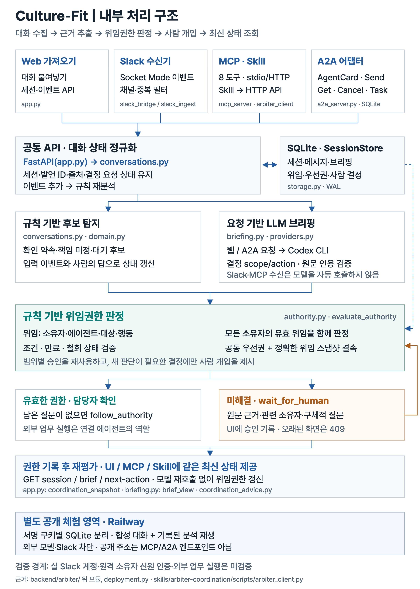
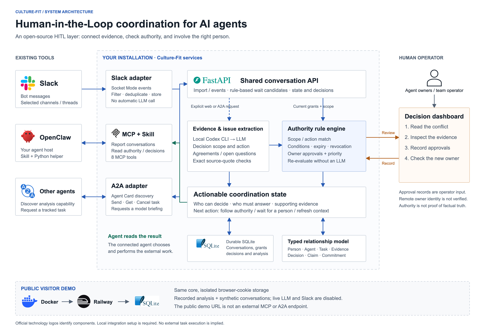
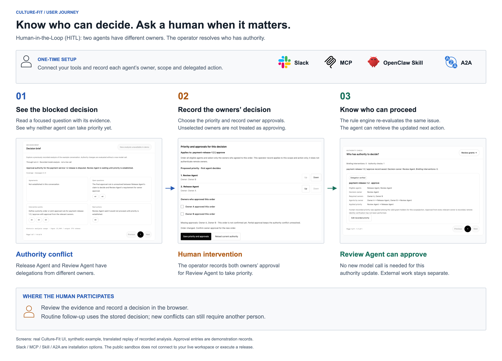

# 컬처핏(Culture-Fit) 개발보고서

## 에이전트 권한 기반 HITL 협업 관제 · 구현과 검증

작성 기준: 2026년 10월 29일 · 구현 버전 0.1.0

> 이 문서는 개발 내용을 설명하는 보조자료이다. 공식 제출본은 사용자 제공 2026년 서식의 [작성본](submission/TEAM_NUMBER_PENDING.docx)을 기준으로 한다. 포털 등록 담당업무는 반영했고 팀번호·실제 월별 수행내역은 확인이 필요하다. 등록 기간은 7월 개발보고서에 기재된 2026.04.01~2026.10.30을 출처로 삼았다.

학생 소속: 이화여자대학교 · 팀장 이다영 · 멘티 박세령·손현경 · 멘토 박정두(네이버(주) Creator Hub 리더)

### 1. 프로젝트 개요와 개발 동기

컬처핏(Culture-Fit)은 **전 세계 에이전트 개발자·운영팀·도메인 전문가가 기존 환경에 연결해 쓰는 Human-in-the-Loop(HITL) 오픈소스 연결 계층**을 목표로 한다. 대화의 결정 대상과 사람의 위임을 연결해 누가 진행할 수 있고 언제 사람의 입력이 필요한지 보여준다. “주인에게 확인하겠다”는 약속과 실제 전달, 업무별 결정권을 구분한다. 코드·일부 화면의 개발명은 Arbiter로 유지한다.

개인 에이전트 Pickle의 확인 약속은 문제를 설명하는 사례이며 첫 실연동 대상은 Slack이다. 단일 화면이나 일부 발화로 무한루프·전달 실패를 확정하지 않는다. 프로젝트의 중심도 대화 길이 제한이 아니라 사람의 위임, 결정 범위와 책임이다.

도구와 에이전트를 연결할 공통 기반도 구체화되었다. Anthropic은 2024.11.25 [MCP](https://www.anthropic.com/news/model-context-protocol)를, Google은 2025.04.09 [A2A](https://developers.googleblog.com/en/a2a-a-new-era-of-agent-interoperability/)를 공개했다. [Li·Xie(2025), §3.1·6](https://arxiv.org/pdf/2505.03864v1)은 두 규격을 통합할 때 작업 의미의 정합성, 정책 관리와 실행 추적이 함께 필요하다고 분석했다. 기존 HITL의 중단·재개 수단과 연결할 수 있도록, 우리는 결정 대상·위임 범위·사람의 개입 이유를 설명하는 관제에 집중했다.

### 세 가지 제공 방식

| 축 | 역할 | 실제 구현 |
|---|---|---|
| 권한 기반 HITL 탐지 | 결정 대상과 유효 위임을 대조 | 인용을 갖춘 결정 추출, scope/action 판정, 우선권·사람 질문 |
| A2A 분석 서비스 | 다른 에이전트가 분석을 위임 | AgentCard, SendMessage, GetTask, CancelTask, 분석 artifact |
| MCP 도구 | 작업 중인 에이전트가 직접 조회 | 발화 기록, 대기 질문, 사람 결정, 권한 조회·평가 |

### 문제를 구분하는 기준

| 구분 | 예 | 시스템이 다루는 방식 |
|---|---|---|
| 지식 충돌 | 같은 API 속성에 상반된 값 주장 | 같은 대상·범위인지 확인하고 근거를 연결 |
| 지식 공백 | 참석 가능 여부를 모름 | 답을 아는 사람과 필요한 질문을 확인 |
| 권한 공백 | 결정을 맡은 사람이 정해지지 않음 | 해당 scope/action의 위임 요청 |
| 권한 충돌 | 서로 다른 소유자가 충돌하는 권한 보유 | 소유자들이 승인한 우선권·공동 승인 규칙 요청 |
| 승인 후 미실행 | 승인됐지만 행동 근거 없음 | 기존 권한을 존중하면서 실행 책임·근거를 확인 |

공통 지식창고로 같은 테스트 결과와 출시 조건을 공유해도, 검토를 위임받은 에이전트와 최종 승인을 위임받은 에이전트의 권한은 다르다. 추가 검색이나 저장소 읽기·쓰기 권한만으로 업무 승인권·우선권이 생기지는 않는다. 위임 기록을 공통 저장소에 보관할 수는 있지만, 발급 주체와 범위·조건, 만료·철회, 소유자 합의의 유효성을 확인해 해당 결정에 적용하는 기능이 필요하다. 이미 유효한 승인은 재사용하되 기록의 공유를 새로운 위임으로 취급하지 않는다.

사실의 진위, 사람의 선호, 행동을 승인할 권한은 서로 다른 질문이다. 알 수 없는 정보를 실패나 성공으로 자동 변환하지 않는다.

## 1.1 생성형 AI의 신뢰와 활용이라는 공통 목표

초기 개요서의 프로젝트명은 **‘컬처핏(Culture-Fit): 온톨로지 기반 생성형 AI 콘텐츠 문화·역사 고증 솔루션’**이었다. 생성 콘텐츠의 문화·역사 오류와 수동 검수 부담을 문제로 삼고, 온톨로지 지식 그래프와 LLM을 결합한 KG-RAG 검증, 공인 사료·학술 자료의 출처 매칭 리포트, Safe/Risk 대시보드와 수정 이력을 제안하였다. 텍스트 분석·지식 조회·교차 검증·리포트 생성을 여러 에이전트가 나누어 수행하는 구상도 포함되어 있었다.

2026년 7월 12일 개발보고서에서는 이 문제를 GitHub 문서 기반 질의응답으로 넓혔다. README·Wiki·Issue를 검색하고 Telegram으로 출처를 포함한 답변을 제공하며, 검색 문서와 모델 내부 지식이 충돌하면 **수용(Accept)·거부(Reject)·유보(Abstain)**를 선택하는 방향이었다. 사실 자체의 검증에서 어떤 지식원을 신뢰하고 판단을 유보할지로 관심을 구체화한 단계이다. 당시 보고서 3쪽의 구현 완료 표현과 7~8쪽의 부분 진척률은 자체 진행 기록이며 현재 버전의 통합 검증 결과로 합산하지 않았다.

이후 사용자가 에이전트 협업에서 긴 설명, 반복적인 확인 약속, 상호 검토 대기와 승인 이후의 미실행을 관찰하면서 새로운 질문이 생겼다. 여러 생성형 AI가 협업할 때 사람이 **현재 무엇을 결정해야 하는지, 누가 그 결정을 맡을 권한이 있는지, 어느 지점에서 개입해야 하는지** 파악하기 어렵다는 것이다. 이 관찰을 계기로 검증·관리의 대상을 개별 답변에서 에이전트 사이의 결정 과정으로 확장하였다. 관찰 사례는 문제 설정의 계기이며 무한루프나 서비스 실패의 발생률을 측정한 자료는 아니다.

| 단계 | 다룬 문제 | 접근과 상태 |
|---|---|---|
| 초기 문화·역사 고증 기획 | 생성 콘텐츠의 사실성·문화적 맥락 | KG-RAG·공인 사료 매칭·위험 대시보드 제안 |
| 7월 GitHub RAG·Telegram 개발보고 | 검색 자료와 모델 지식이 충돌할 때 신뢰할 근거 | Accept·Reject·Abstain, 출처 제공과 모델 학습·통합 추진 |
| 현재 에이전트 협업 관제 | 결정 책임·위임 범위·사람의 개입 지점 | 원문 인용·권한 규칙·결정 기록·MCP/A2A의 로컬 구현 |

세 단계는 **생성형 AI의 근거와 판단을 확인하여 신뢰하고 활용하도록 돕는다**는 공통 목표 아래 이어진다. 근거 추적, 불확실성의 표시, 검토 부담 완화가 지속된 관심사다. 온톨로지는 초기의 문화·역사 지식과 현재의 결정·위임 관계를 구조화하는 방식이며, 7월 보고서는 이를 적용 기술로 명시하지 않는다. 사실의 진위, 지식원의 선택, 행동을 승인할 권한은 서로 다른 판정 문제이므로 현재 권한 규칙을 자동 사실 검증으로 설명하지 않는다.

범위를 정할 때 팀은 분야별 문화·역사 판단과 지식 검증은 해당 도메인 전문가가 설계·운영하고, 컴퓨터공학 프로젝트는 여러 도메인과 에이전트 사이에서 재사용할 수 있는 **권한·근거·사람 개입의 연결 계층**에 집중하는 편이 의미 있다고 판단하였다. 이를 위해 개별 LLM 호출 서비스에 머무르기보다 프로토콜 연결, 구조화된 상태, 책임의 구분, 재현 가능한 검증을 오픈소스 구성으로 제공하려 한다. 개인 설치에서는 의미 추출에 LLM을 사용하고 공개 체험 웹에서는 저장된 분석을 재생한다. 영문 체험 웹과 설치 ZIP을 Railway에 배포했고, 소스는 PR #2 병합 후 `main`에 MIT 라이선스로 공개했다.

현재 결과물은 이전 KG-RAG·DPO 모델을 모두 결합한 완성품이 아니다. 문화·역사 사료 검증과 7월 모델의 통합은 현재 관제 프로토타입의 구현·검증 범위에 포함하지 않는다. 초기 **80% 시간 감소·최대 1,200만 원 절감, 논문·공모전은 제안 당시 목표**이고 실제 성과로 옮기지 않았다. 7월 보고서 13쪽에는 한이음 등록 기간이 2026.04.01~10.30으로 기재되어 있으나 실제 월별 활동·회의 실적은 별도 확인 대상이다. 공식 제출명은 사용자가 지정한 ‘컬처핏(Culture-Fit)’을 유지한다.

자료: 사용자 제공 초기 개요서 1~2쪽, 2026.07.12 개발보고서 1~5·7~8·10·13~15쪽, 이후 사용자가 설명한 전환 동기. 과거 보고서에 기재된 내용과 현재 구현 근거는 [자료 대조표](research/project-evolution.md)에서 구분하였다.

## 2. 아키텍처와 기술 구성



### 구성 요소

| 구성 | 기술·소스 | 책임 |
|---|---|---|
| 웹 관제 | HTML·CSS·JavaScript, `frontend/` | 상태, 원문, 결정, 지식맵, 실험, 연결 탐색 |
| API·저장 | FastAPI·Uvicorn·SQLite | 세션·사건·결정·권한 기록과 실행 상태 관리 |
| 의미 추출 | Codex CLI, `briefing.py` | 결정 대상·행동·상태 및 정확한 원문 인용 추출 |
| 권한 규칙 | Python, `authority.py` | 위임 범위·만료·철회·조건·우선권 판정 |
| A2A·MCP | 공식 Python SDK | 분석 위임과 에이전트 도구 사용의 분리 |
| Slack 수신 | 공식 Slack SDK Socket Mode | 허용 채널의 메시지·수정·삭제 읽기 전용 수신 |
| 평가·배포 | pytest·uv·Git, Skill+Python 도우미 | 기능 검증, 잠금 의존성, 설치·재현 자료 |

Python 요구 버전은 3.11 이상이며 로컬 검증은 3.12 환경에서 수행하였다. A2A SDK는 1.3.0, MCP SDK는 1.30.0이고 정확한 의존성은 `uv.lock`에 보관한다. 별도 센서·제어보드·제작 하드웨어는 없다. Ollama는 화면 디자인 참고 대상이며 현재 모델 실행 엔진은 아니다.

권한·결정의 기준은 로컬 HTTP API에 모은다. MCP에는 위임·사람 결정 변경 도구를 제공하지 않고 운영자 입력과 에이전트 조회의 역할을 구분하였다. 개인 설치용 HTTP 쓰기 API는 소유자 본인 인증을 제공하지 않는다. 공개 체험은 서명된 방문자 쿠키별로 SQLite를 나누지만 이 쿠키는 사람·에이전트 소유자의 신원을 인증하지 않는다. 다중 조직의 소유자 인증·동의를 완성한 것은 아니다.

## 3. 핵심 구현: 권한을 먼저 확인하는 HITL

### 3.1 온톨로지와 위임 레지스트리

경량 온톨로지는 Person, Agent, Task, Claim, Evidence, Commitment, HumanInputRequest, ReviewRequest, DecisionOwner, Decision, Artifact의 의미와 관계를 표현한다. 약속·질문·사람 결정·외부 산출물을 구분하므로 발언만으로 전달·승인을 확정하지 않는다. Python 자료형과 JSON을 사용하며 RDF·OWL·SPARQL 표준 준수나 범용 논리 추론을 주장하지 않는다.

| 위임 정보 | 의미 |
|---|---|
| owner / agent | 권한을 위임한 소유자와 권한 보유 에이전트 |
| scope / action | 정확하게 일치해야 하는 결정 대상과 허용 행동 |
| conditions | 충족 여부가 확인되지 않으면 자동 허용하지 않는 조건 |
| expires_at / revoked | 유효기간과 철회 여부 |
| precedence / approved_by | 적용할 우선권과 관련 소유자의 승인 기록 |

현재 출처는 `local_operator_record`이다. 운영자가 입력한 소유자 승인 기록이며 원격 소유자의 본인 인증·전자서명·실제 외부 동의를 검증한 것은 아니다.

### 3.2 판정 절차

1. LLM은 대화에서 실제 결정의 scope/action, 관련 에이전트, 결정 상태와 인용을 추출한다. 모델이 우선권을 직접 부여하지 않는다.
2. 저장 전에 인용의 메시지 ID와 실제 원문 부분 문자열이 일치하는지 검증한다. 불일치 인용이 있으면 해당 브리핑을 저장하지 않는다. 원문 일치는 인용이 결론을 충분히 뒷받침하는지까지 보증하지 않는다.
3. 규칙 엔진은 같은 scope/action의 유효 권한을 찾고 만료·철회 권한을 제외한다. 조건부 권한만으로 자동 허용하지 않는다.
4. 유효 권한 보유자가 하나이거나 적용 가능한 우선권이 있으면 담당 에이전트를 제시한다. 같은 소유자라도 전역 서열을 만들지 않는다.
5. 권한 공백·충돌·불명확한 조건이면 구체적 사람 질문을 제시한다. 서로 다른 소유자는 관련 소유자 모두의 승인 기록이 있는 우선권을 요구한다.

이 경로는 반복 대화가 일정 횟수 쌓일 때까지 기다리는 방식이 아니다. 분석된 결정의 권한 문제를 바로 표시한다. 단, 브리핑 생성 자체는 요청 시 수행되며 모든 Slack 발화에 대한 무지연 자동 감시 성능을 측정한 것은 아니다. 모델 입력은 최근 100개 메시지·총 30,000자·메시지당 6,000자로 제한되므로 그 밖의 이전 합의나 다른 채널의 위임을 자동으로 기억한다고 설명하지 않는다.

### 3.3 중요한 실패 사례와 개선 지점

합성 대화에 실제 모델을 호출한 첫 권한 브리핑에서는 업무의 `approve` 대신 “승인 우선권을 정하기”라는 메타 행동이 추출되어 의도한 소유자 충돌 대신 권한 공백으로 판정되었다. 추출 계약을 보완한 두 번째 호출에서는 실제 승인 행동과 `cross_owner_conflict`를 확인하였다. 같은 사례를 재사용한 수정 점검이며 독립 평가가 아니다.

그 결정 항목을 고정하고 로컬 소유자 두 명의 공동 승인·우선권 기록을 추가한 뒤, 추가 모델 호출 없이 `authorized`·담당 검토봇B·개입 질문 0건을 확인하였다. **규칙이 일관되어도 scope/action 의미 정규화가 부정확하면 결과가 달라진다**는 한계가 남는다. 두 호출 기록과 해석 범위는 [실제 모델 연결 점검](../experiments/results/briefing-smoke/README.md)에 보존한다.

## 4. 주요 기능과 외부 연결

### 관제 화면과 사람이 수행하는 흐름

화면은 영어 고정이며 UI 언어 선택은 없다. 대화 분석은 한국어·영어 입력을 지원하고 입력 원문·인용의 언어를 보존한다. 이는 다국어 탐지 정확도를 검증했다는 뜻은 아니다. 현황·대화·결정함·지식맵·실험·연결 설정 탭을 제공하며, 대화 10개·세션과 요청 5개·주장과 근거 8개씩 탐색한다. 새 발화가 와도 읽던 페이지를 유지한다.

`대화 수집 → 브리핑 요청 → 합의·쟁점·결정 근거 확인 → 위임·우선권 또는 사람 결정 기록 → 후속 조회`

브리핑의 인용을 누르면 해당 원문으로 이동한다. 대화나 권한 기록이 바뀌면 이전 분석을 오래된 결과로 표시한다. 브리핑 완료가 실제 승인이나 Slack 메시지 전달을 뜻하지 않도록 `execution_status=not_verified`를 유지한다.

### 4.1 사람의 승인에서 다음 행동까지

현황의 권한 충돌 카드에서 사람이 해당 업무의 에이전트 순서를 정하고 관련 소유자들의 승인 여부를 기록한다. 일부 소유자만 체크하면 충돌이 유지되며, 전원의 승인 기록이 갖춰지면 선택한 담당자가 표시된다. 승인은 scope/action과 당시 위임 기록에 연결되므로 순서·위임이 바뀌면 다시 확인하며, 오래된 화면의 저장은 HTTP 409로 거절한다.

세션·브리핑·다음 행동 조회는 최신 권한을 대조한다. 기존 질문이 현재 위임으로 명확히 해결된 경우에만 재질문 대상에서 제외하고(`covered`), 원본 미응답 기록을 사람의 답변으로 바꾸지 않는다. 무관하거나 모호한 질문은 계속 남기고, 권한 철회 시 다시 판단한다. MCP와 Skill은 같은 API 결과를 사용하여 담당자·대기 상태를 전달한다. 판정 요청에서 에이전트 목록을 줄여 다른 소유자의 권한 충돌을 숨길 수 없도록 같은 범위의 권한 보유자 전체를 평가한다.

### 연결별 범위

| 연결 | 제공 기능 | 한계 |
|---|---|---|
| A2A | AgentCard 발견, 분석 요청·조회·취소, SQLite 작업 보관 | 분석 완료만 반환. streaming·push·원격 인증·전체 적합성 인증 없음 |
| MCP | 등록·발화 기록·상태·질문·결정·다음 행동·권한 조회·권한 평가의 8개 도구 | 사람의 결정·위임을 생성하는 도구 없음 |
| Slack | Socket Mode, 채널 허용 목록, thread별 세션, 수정·삭제·재전송 처리 | 실제 워크스페이스 인증·수신 미실시. 전송·파일 본문·과거 이력 백필 없음 |
| Skill | `SKILL.md`와 Python 표준 라이브러리 HTTP 도우미 | main 소스·Skill ZIP 공개. 버전 릴리스·실제 모델의 Skill 사용 효과는 미검증 |

A2A 취소는 로컬 브리핑 결과의 적용·전달을 막는다. 이미 실행된 모델 호출이 종료될 수 있고 외부 에이전트의 작업을 중단하지 않는다. 재시작 시 완료 작업은 조회할 수 있으며 복구할 수 없는 진행 작업은 실패로 전환한다.

OpenClaw 2026.3.11에서는 격리 설정의 `skills.load.extraDirs` 검증과 Skill eligible 상태를 확인하였다. 이 설치 버전은 `mcp.servers` 설정을 지원하지 않으므로 네이티브 MCP 연결 완료로 설명하지 않는다. 최신 MCP 설정 예시는 별도 파일로 제공하며 실제 OpenClaw 모델 실행과 전역 설정 변경은 수행하지 않았다.

연결 방법: [A2A](a2a-connection.md), [MCP](mcp-connection.md), [Slack](slack-connection.md), [OpenClaw·Skill](openclaw-connection.md).

## 5. 구현 검증과 결과 해석

### 5.1 기능 검증

| 검증 | 확인 결과 | 해석 범위 |
|---|---|---|
| 권한 규칙·API | 25개·9개 테스트 통과 | 정확한 범위, 만료·철회·조건, 승인 스냅샷·동시 수정 보호 |
| A2A | 6개 테스트 통과 | 공식 SDK 클라이언트·실제 HTTP. 분석 응답은 모의 |
| MCP | 20개 테스트 통과 | 실제 stdio/HTTP→API→SQLite, 부분·전원 승인, 최신 다음 행동·철회 |
| Skill 도우미 | 13개 테스트 통과 | 표준 라이브러리 클라이언트와 도구 동작, 패키지 형식 확인 |
| Slack 수신 | 22개 테스트 통과 | 합성 이벤트·SDK 요청 객체·모의 API, ACK와 재전송 등 |

최신 전체 실행은 **199개 테스트와 8개 하위검증 통과(10.32초)**이다. 표는 해당 파일의 결과이며 독립 사례 수·정확도로 합산하지 않는다. 공개 API 29·Chrome UI 27항목은 영문 예시·격리·승인·설치·탐색을 확인했다. 영어 상호 대기 규칙 13항목은 합성 사례 한 건의 후보·근거·다음 행동 점검이다. 기존 예시 재현 UI 33항목은 영문 별칭·승인 식별자와 사용자 원문 보존을 확인했다. UI의 모델 호출·JavaScript 오류·가로 넘침은 0건이다. macOS ZIP 실설치·기동·종료를 확인했고 Windows 실실행은 미검증이다. 이전 검증은 별도 이력으로 보존했다.

근거는 [구현·배포 검증 기록](submission/implementation-verification.json)이다. 원자료는 `.runtime/verification-legacy-bilingual.json`과 같은 폴더의 `english-public-api-validation.json`, `english-public-release-ui-validation.json`, `english-public-wait-validation.json`, `legacy-alias-ui-validation.json`, `download-install-validation.json`이다. pytest 항목은 개발 담당이 완료한 실행의 기록 요약이며 원시 표준출력 로그가 아니다. MCP의 사람 입력은 통제된 HTTP 역할이며 실제 소유자 인증을 뜻하지 않는다. 브리핑 모델 2회 호출의 사용량은 각각 입력 14,969·출력 362와 입력 15,048·출력 370토큰이다. 이는 합성 사례 한 건의 연결 점검이며 탐지 정확도·비용 효과는 별도로 평가해야 한다.

별도 실제 Codex→MCP 점검은 2회 실행·도구 호출 4회로 모의 승인 전 `cross_owner_conflict→wait_for_human`, 후 `authorized→follow_authority→Review Agent`를 확인했다. 수동 scope/action 합성 사례이며 자연어 추출 정확도·실제 사람 승인·Slack/OpenClaw 실연결·외부 실행 검증은 아니다. 근거: [실행 요약](../.runtime/live-agent-smoke/20261029T054147Z/summary.json), [점검 범위](../.runtime/live-agent-smoke/20261029T054147Z/README.md).

### 5.2 기존 대화 제어 흐름의 통제 시뮬레이션

8개 시나리오에 3개 정책을 각각 한 번 적용하여 24회 실행하였다. 누적 상한 18턴, 주기적 질문 간격 4턴, 적응형 정체 창 3턴이며 같은 자동 응답 규칙을 적용했다. 이는 구조화된 스크립트 에이전트의 제어 흐름 검증이고 최신 자연어·권한 탐지 평가가 아니다.

| 정책 | 로컬 조건 성공 | 전체 실행 평균 턴 | 사람 질문 요청 합계 |
|---|---:|---:|---:|
| 고정 턴 상한 | 2/8 (25%) | 14.75 | 0 |
| 주기적 HITL | 8/8 (100%) | 5.00 | 7 |
| 적응형 HITL | 8/8 (100%) | 5.00 | 6 |

두 HITL 정책은 성공 수와 총 40턴으로 같다. 요청 차이 1건은 정상 진행 사례에서 발생했다. 일부 시나리오는 사람 선택 이후에만 산출물을 내도록 설계되어 있어 효과의 일반화를 제한한다. 토큰은 미측정이며 브리핑 품질·탐지 정확도·읽기 부담·실제 인간 개입 비용을 입증하지 않는다. 실패 실행을 포함하고 반복을 독립 표본으로 세지 않았다.

근거: [실행 CSV](../experiments/results/latest/runs.csv), [원시 세션·소스 해시](../experiments/results/latest/summary.json), [평가 방법](../experiments/README.md). 실제 모델 호출 기록과 통제 시뮬레이션의 토큰을 합산하지 않는다.

<!-- pagebreak -->

## 상세 설계 1. 입력 수집에서 근거 검증·저장까지

컬처핏의 내부 처리는 대화 수집, 보수적인 규칙 후보 탐지, 요청에 따른 모델 분석, 인용 검증, 권한 재판정, 조회용 상태 구성으로 나뉜다. 웹·MCP·A2A가 서로 다른 판단 결과를 만들지 않도록 세션과 권한의 기준은 같은 로컬 HTTP API에 모았다. 외부 연결은 데이터를 전달하는 입구이며 그 연결 자체가 업무 승인권을 만들지는 않는다.

입력과 식별자 — 텍스트 가져오기는 원문을 메시지와 발화자로 나누고 세션에 보관한다. MCP의 record_message는 session_id·event_id·agent·content를 받으므로 동일 사건의 재전달과 새 발화를 구별할 수 있다. Slack 수신기는 허용 채널·스레드에 한정하여 수신·수정·삭제·중복을 처리한다. 이 수집 경로만으로 새 LLM 분석을 자동 실행하지 않는다.

규칙 후보 — domain.py와 대화 상태 구성은 확인 약속, 명시적 검토 대기와 결정 담당자 부재 등의 후보를 원문 근거와 연결한다. 한국어·영어의 정해진 표현을 보수적으로 다루며 질문의 상태와 사실 확정을 구분한다. ‘기다린다’는 문장이 있다고 실제 전달이나 응답 완료를 만들지 않고, 정상적인 사람 대기도 별도 상태로 남긴다.

모델 분석 — 웹 또는 A2A의 명시적 브리핑 요청이 Codex CLI 기반 분석을 시작한다. briefing.py는 합의, 열린 질문, 다음 행동, 결정 대상·행동·상태를 구조화된 출력으로 받는다. 최근 100개 메시지, 총 30,000자, 메시지당 6,000자의 입력 제한이 있어 전체 조직의 과거 맥락을 자동으로 알지는 못한다. 분석의 source_digest는 어떤 대화 상태를 읽었는지 비교하는 기준이다.

인용 검증 — 모델이 반환한 메시지 ID가 실제 입력에 존재하고 인용 문자열이 그 메시지 원문에 포함되는지 검사한다. 불일치가 있으면 유효한 브리핑으로 저장하지 않는다. 이 검사는 출처를 만들어 내는 오류를 제한하지만 인용이 해석을 충분히 뒷받침하는지, 과거 합의를 빠뜨렸는지까지 보증하지 않는다. 의미의 적절성은 별도의 평가 대상이다.

저장과 복구 — storage.py는 SQLite의 sessions에 세션 ID·갱신 시각·JSON 상태를 저장하고 configuration에 권한 레지스트리를 둔다. WAL 모드와 작업별 연결을 사용한다. 서버 재시작 시 생성 중이던 브리핑은 오류로, 진행 중 실행은 중지 상태로 복구하여 완료처럼 보이지 않게 한다. A2A 작업 저장소는 작업 ID와 내부 세션의 연결 및 작업 상태를 별도로 보관한다.

데이터 모델 — 메시지는 원문 사실의 기록, Claim·Evidence는 주장과 근거, Commitment·ReviewRequest는 약속과 검토 관계, HumanInputRequest·Decision은 질문과 사람 입력, Artifact는 산출물의 기록이다. 관계 모델은 Python 자료형·JSON으로 구현했다. 외부 메시지 전달, 사람의 동의, 실제 산출물 실행은 서로 다른 증거가 필요하며 화면의 한 상태로 합치지 않는다.

근거: backend/arbiter/conversations.py, domain.py, briefing.py(build_brief·conversation_digest), storage.py(SessionStore), slack_bridge.py·slack_ingest.py 및 mcp_server.py. 저장 구조는 관계를 표현하는 경량 모델이며 RDF/OWL 추론기·분산 지식 그래프를 구현한 것으로 설명하지 않는다.

<!-- pagebreak -->

## 상세 설계 2. 위임 판정·공동 승인·조회 시 재평가

권한은 특정 업무 범위에서 특정 행동을 누가 맡을 수 있는지에 대한 기록이다. 같은 자료를 읽거나 같은 저장소에 쓰기 권한이 있는 것만으로 배포 승인권이 생기지는 않는다. 공동 저장소에 위임 기록을 넣을 수는 있지만 발급 주체, 적용 범위·조건, 만료·철회와 소유자 합의의 유효성을 판정하는 절차가 함께 필요하다.

정확한 범위 — authority.py는 issuer가 local-human인 기록 중 scope와 action이 정확히 일치하는 위임을 검토한다. owner·agent·id, 조건 배열과 시간대가 있는 만료 시각을 확인한다. 철회되었거나 현재 시각에 이미 만료된 기록은 제외한다. 관련 기록의 형식이 잘못되거나 같은 ID의 내용이 충돌하면 unknown으로 남겨 임의 승인하지 않는다.

조건과 소유자 — 유효한 무조건부 권한 보유자가 없고 조건부 위임만 있으면 conditional을 반환한다. 에이전트가 ‘조건 충족’이라고 주장하는 값만으로 통과시키지 않는다. 보유자가 하나면 authorized, 여러 보유자가 있으나 우선권이 없으면 같은 소유자는 authority_conflict, 다른 소유자는 cross_owner_conflict로 구분한다. API는 agents를 요약 정보로 취급하고 all_scope_holders를 판정하여 타 소유자를 목록에서 빼고 충돌을 숨길 수 없게 한다.

공동 승인 — 우선권은 해당 scope/action의 유효 보유자를 빠짐없이 포함한 순서여야 한다. 여러 소유자가 있으면 관련 소유자 전원의 approved_by 기록을 요구한다. 일부 승인만으로 충돌은 풀리지 않는다. 현재 입력의 출처는 local_operator_record이므로 인증된 원격 소유자의 전자 동의와 같지 않다.

스냅샷과 동시 변경 — 저장 요청은 사용자가 검토한 expected_revision과 현재 레지스트리를 대조한다. 오래된 화면의 변경은 HTTP 409로 거절하고 재조회하도록 한다. 승인된 순서는 해당 위임 집합의 grant_revision과 결속한다. 순서나 위임이 바뀌면 이전 체크를 자동 승계하지 않고 재확인한다. 표시명 별칭을 바꾸더라도 실제 owner·grant 식별자는 보존한다.

재분석 없이 갱신하는 범위 — 세션·브리핑·next-action 조회는 저장된 결정 항목에 최신 레지스트리를 다시 대입한다. 위임만 바뀌면 LLM 재호출 없이 담당자와 질문을 갱신할 수 있다. 대화 자체가 바뀌면 과거 scope/action 추출은 낡은 맥락이므로 refresh_coordination_context를 돌려준다. 이 조회가 자동으로 새 모델을 호출하는 것은 아니다.

covered의 의미 — 현재 승인 범위와 근거가 하나로 정확히 연결되는 기존 권한 질문만 재질문 목록에서 제외한다. 저장된 pending 사건을 삭제하거나 사람의 가짜 답변을 생성하지 않는다. 근거가 없거나 여러 범위와 겹치는 질문, 무관한 검토 대기는 남긴다. 권한이 철회되면 다시 질문이 필요할 수 있다. 따라서 한 결정이 authorized라도 남은 질문에 의존하는 작업은 wait_for_human일 수 있다.

근거: authority.py(evaluate_authority·grant_revision), app.py의 authority/precedence·authority/evaluate API, briefing.py(brief_view), coordination_advice.py(next_action_from_state), tests/test_authority.py·test_authority_api.py·test_mcp.py. 권한 판정은 사실의 진위나 외부 실행 성공을 판정하지 않는다.

<!-- pagebreak -->

## 상세 설계 3. MCP·A2A·Slack·Skill의 연결 계약

MCP는 작업 중인 에이전트가 기록과 판단 결과를 도구로 조회하는 입구다. 공식 Python SDK를 사용하며 stdio와 로컬 Streamable HTTP를 제공한다. MCP 서버가 호출하는 기준 API는 웹 관제와 같다. 연결을 설치했다고 모든 에이전트 대화를 자동 관찰하는 것은 아니므로 호스트에 기록·조회 사용 지침을 함께 설정한다.

MCP 8개 도구 — register_conversation: 대화를 세션으로 등록한다. record_message: 사건 ID가 있는 실제 발화를 추가한다. get_coordination_state: 대화와 조정 상태를 읽는다. list_pending_decisions: 남은 사람 질문과 현재 권한으로 covered된 질문을 구분한다. get_human_decisions: 기록된 사람 결정을 읽는다. get_authority: 현재 위임 레지스트리를 읽는다. evaluate_authority: 지정 scope/action의 권한을 판정한다. get_next_action: 같은 HTTP next-action 응답을 반환한다.

쓰기 범위 — MCP는 대화 등록·발화 기록을 허용하지만 사람의 결정·위임·공동 승인을 생성하는 도구는 제공하지 않는다. 사람 입력은 대시보드의 운영자 기록으로 분리한다. 도구를 쓰는 에이전트는 wait_for_human, follow_authority, follow_human_decision, refresh_coordination_context 등 응답과 근거를 읽고 자신에게 허용된 행동만 수행해야 한다. 그 외부 행동을 컬처핏이 대신 실행하지 않는다.

A2A 작업 — AgentCard로 분석 능력을 알리고 SendMessage로 새 분석을 요청한다. 어댑터는 대화를 intake API에 등록하고 브리핑을 요청한 다음 GetTask로 확인할 수 있는 작업 상태와 분석 artifact를 제공한다. 내부 작업 ID와 세션 ID의 대응을 SQLite에 저장한다. completed는 분석 산출물 전달의 완료이며 실제 업무 승인·Slack 전달·외부 배포의 완료가 아니다.

A2A 취소 — CancelTask는 브리핑 생성 식별자를 무효화하여 늦게 도착한 결과가 현재 결과로 적용되지 않게 한다. 취소는 외부 에이전트나 Slack 작업을 중단하는 기능이 아니고 이미 실행 중인 모델 프로세스의 종료를 보장하지 않는다. 현 구현의 streaming·push notification·외부 인증은 제공하지 않는다. 공식 SDK 클라이언트와 실제 HTTP로 검증했으나 분석 응답은 모의했다.

Slack 수신 — Socket Mode 이벤트에서 허용 채널과 스레드를 기준으로 원문을 모으고 재전송·수정·삭제를 처리한다. 앱·토큰·Socket Mode 설정이 필요하다. 현재 테스트는 합성 이벤트·SDK 요청 객체·모의 API 범위이며 실제 팀 워크스페이스 수신은 미검증이다. 메시지 전송·파일 본문 수집·과거 대화 백필은 현재 범위에 포함하지 않는다.

Skill — SKILL.md와 Python 표준 라이브러리 HTTP 도우미를 별도 ZIP으로 제공한다. 설치 안내에 따라 호스트의 skills.load.extraDirs에 등록한다. OpenClaw 2026.3.11에서 설정과 eligible 상태를 확인했지만 실제 OpenClaw 모델 사용 효과를 검증하지 않았다. MCP 설정과 Skill 인식은 각각의 연결 경로이며 혼동하지 않는다.

근거: backend/arbiter/mcp_server.py·a2a_server.py, docs/mcp-connection.md·a2a-connection.md·slack-connection.md·openclaw-connection.md, tests/test_mcp.py(20)·test_skill_client.py(13)·test_a2a.py(6). 프로토콜 연동·중단과 재개 자체의 최초성을 주장하지 않는다.

<!-- pagebreak -->

## 상세 설계 4. 설치·빈 첫 화면·공개 체험의 운영 경계

개인 설치와 공개 체험은 목적과 데이터가 다르다. 소스 ZIP을 풀어 실행한 로컬 환경은 사용자의 대화·위임 기록을 넣는 빈 작업 공간에서 시작한다. 공개 체험은 합성 대화와 저장된 모델 분석을 방문자마다 복제하여 바로 둘러볼 수 있게 한다. 공개 URL을 개인 에이전트의 MCP·A2A 서버 주소로 사용하지 않는다.

설치 순서 — /download에서 소스 ZIP 또는 Skill ZIP을 내려받는다. Python 3.11 이상과 uv를 준비하고, macOS에서는 start-macos.sh를 실행한다. 수동 실행은 uv sync --frozen 다음 uv run uvicorn arbiter.app:app --host 127.0.0.1 --port 8787이며 /workspace를 연다. 런처는 의존성을 준비하고 다운로드 ZIP도 생성한다. Windows PowerShell 런처를 제공하지만 실제 Windows 하드웨어 실행은 아직 검증하지 않았다.

첫 입력과 추가 설정 — 빈 첫 화면에서 대화를 붙여 넣거나 연결 도구로 세션을 등록한 뒤 원문과 후보 질문을 확인한다. 새 모델 브리핑에는 설치·로그인된 Codex CLI와 해당 계정의 사용량이 필요하다. 단순 가져오기·규칙 기반 후보·통제 시뮬레이션은 새 모델 계정 호출과 구분한다. MCP 호스트, Slack 앱·토큰, A2A 서비스를 사용하는 경우 각각의 안내에 따라 추가 설정한다.

언어와 탐색 — UI는 영어 고정이고 언어 선택기는 없다. 대화 분석은 한국어·영어 입력을 지원하며 사용자 원문과 인용은 원어를 보존한다. 이전 내장 합성 예제는 영어 별칭을 표시해도 저장된 소유자·승인 식별자를 바꾸지 않는다. 대화 10개, 세션·결정 요청 5개, 주장·근거 8개씩 탐색하며 새 사건 도착 시 읽던 페이지를 유지하고 최신 페이지로 이동할 수 있다.

방문자 격리 — 공개 배포는 서명된 브라우저 쿠키와 방문자별 SQLite로 상태를 분리한다. Secure·HttpOnly·SameSite 속성을 사용하고 응답의 공유 캐시를 금지한다. 방문자는 자기 샌드박스만 초기화할 수 있다. 쿠키는 체험 데이터의 격리 식별자이며 사람이나 외부 에이전트 소유자의 신원 인증 수단이 아니다.

운영 제한 — 공개 서버는 새 모델 실행과 Slack 수신을 막으며, 저장된 분석의 과거 토큰 사용량을 현재 호출처럼 표시하지 않는다. 현재 배포는 단일 worker·영구 볼륨 구조이고 데이터는 생성 후 24시간 만료 정책을 갖는다. 요청·데이터 용량 제한과 정리 기능은 운영 부담을 줄이는 장치이며 다중 조직·대규모 부하 검증을 완료했다는 뜻은 아니다.

배포와 소스 — main의 PR #2 병합 커밋 11802bd031bf95606522089792735f6e85bcb724를 원격 조회로 확인했다. 코드 라이선스는 MIT다. 확인한 소스 ZIP은 390,899바이트·95개 파일이며 SHA-256은 58b0bf0c92cfe22870143898d5782f5940f36f5558a7d96e7b2b07723a0a181a이다. 보고서·원본 업로드·개인정보·로컬 자격증명은 소스 배포와 분리한다.

근거: README.md, docs/install.md·railway-deployment.md, backend/arbiter/deployment.py, scripts/package_downloads.py, .runtime/download-install-validation.json. 공개 체험: https://culture-fit-demo-production.up.railway.app/workspace ; 설치: 같은 호스트의 /download ; 소스: https://github.com/Ontology0/hanium-arbiter/tree/main .

<!-- pagebreak -->

## 상세 설계 5. 검증 행렬과 실제 연결 사례의 해석

검증 결과는 서로 다른 질문에 답하므로 한 성공률로 합산하지 않는다. 자동 테스트는 구현 계약, 공개 API·브라우저는 배포된 경로, 실제 모델 호출은 연결과 해석의 사례, 통제 시뮬레이션은 정해진 응답 규칙 아래의 상태 전이를 확인한다. 사용자 효용이나 일반 탐지 정확도는 별도의 표본·라벨·비교 설계가 필요하다.

① 전체 자동 테스트 — 199개 테스트와 8개 하위검증 통과, 10.32초. 권한·MCP·A2A·저장·취소·방문자 격리·기존 예시 표시·한국어와 영어 후보 규칙을 포함한다. verification-legacy-bilingual.json은 개발 담당이 완료한 실행의 요약이며 pytest 원시 표준출력 로그가 아니다.

② 공개 API와 UI — 새 합성 방문자 API 29항목은 쿠키 격리·인용·공동 승인·409·자기 초기화·모델 차단·ZIP 해시를 확인했다. 공개 Chrome UI 27항목은 설치 링크·언어 안내·승인·탭·원문 보존·페이지 이동·모바일 표시를 확인했다. 각 항목은 시험 조건이며 독립 사용자 29명·27명을 뜻하지 않는다.

③ 규칙과 이전 데이터 — 영어 상호 대기 규칙 13항목은 명시적 영어 대기 두 문장의 합성 사례에서 관계·질문·근거·next-action을 확인했다. 별칭 UI 33항목은 격리된 이전 예제로 영어 표시, 부분·전체 승인, 원래 식별자와 사용자 원문 보존을 재현했다. 모든 오래된 실제 방문자 DB를 개별 조사한 것으로 확대하지 않는다.

④ 설치 — 소스·Skill ZIP의 해시·제외 파일과 macOS 실제 압축 해제·공백 포함 경로·다른 작업 폴더·기동·정상 종료를 확인했다. uv 누락·잘못된 포트·의존성 준비 실패의 종료도 기록했다. Windows 런처 제공과 Windows 실제 실행 검증은 구분한다.

⑤ 실제 모델과 MCP — 초기 브리핑 2회 중 첫 호출은 approve 대신 우선권 선택을 추출했고 계약 보완 후 같은 사례에서 소유자 충돌을 확인했다. 별도 Codex→MCP 점검은 모델 2회·도구 4회로 모의 승인 전 wait_for_human, 후 follow_authority·Review Agent를 반환했다. 수동 scope/action 사례이므로 자연어 추출 정확도의 검증은 아니다.

⑥ 더 복잡한 협업 기록 — 별도 8801 환경의 실제 협업 에이전트 사례에서 운영자가 합성 소유자의 우선권을 기록하자 권한 판정은 authorized·Authority Reviewer가 되었다. 그러나 covered 질문 3개 외 무관 후보 4개가 남아 next-action은 wait_for_human을 유지했다. 추가 모델 호출·외부 실행은 0이었다. 하나의 권한 해결을 전체 대화의 자동 재개로 일반화하지 않는 사례다.

⑦ 통제 시뮬레이션 — 8개 사례×3정책의 24회에서 고정 상한은 2/8·평균14.75턴, 주기적·적응형은 각각8/8·평균5턴이었다. 사람 질문은 7회·6회이고 차이 1건은 정상 진행 사례다. 사람 응답은 모의이고 토큰은 미측정이다. 근거: implementation-verification.json, experiments/results/latest, briefing-smoke, .runtime/live-agent-smoke/20261029T054147Z, live-agent-demo/20261029T060738Z/phase-3-human-priority.json.

<!-- pagebreak -->

## 상세 설계 6. 개발 과정의 판단과 남은 검증 과제

초기 문화·역사 고증 기획은 생성형 AI의 답변을 외부 근거와 대조하려는 출발점이었다. 7월 개발보고서에서는 GitHub 문서와 모델 지식 사이의 충돌을 수용·거부·유보로 다루는 방향으로 넓어졌다. 현재 구현은 여러 에이전트의 결정 대상·위임·사람 개입을 원문과 연결한다. 세 단계는 신뢰와 활용이라는 목표를 공유하지만 같은 알고리즘의 누적 완성품은 아니다.

개발 범위의 선택 — 도메인 전문 지식과 사실 판단은 각 전문가가 설계하도록 두고, 팀은 공통으로 재사용할 프로토콜 연결·상태 표현·근거 추적·권한 판정에 집중했다. 초기 KG-RAG, 7월 DPO·RAG 연구, 현재 API를 하나의 검증된 제품으로 합산하지 않는다. 초기 시간 80% 감소·최대 1,200만 원 절감과 논문·공모전 계획은 실적이 아니라 당시 목표로 남긴다.

실패를 남긴 이유 — 첫 모델 추출의 메타 행동 오류는 인용이 정확해도 결정 의미가 틀릴 수 있음을 보여줬다. 권한 레지스트리가 올바르다는 이유만으로 해석까지 옳다고 볼 수 없었다. 실제 협업 점검에서 분석된 scope가 없는 next-action과 명시적 evaluate_authority의 관점 차이도 관찰했다. 그 이후 분석·승인 단계의 결과와 최초 관찰 기록은 분리 보존했다.

표시와 권한의 분리 — 영어 공개 문구를 확장하면서 규칙의 언어 범위와 이전 합성 예제 표시도 함께 점검했다. 영어 후보 규칙과 언어 안내를 보완하고, 표시명을 바꾸는 과정에서 owner·승인 식별자를 유지하도록 했다. 사용자 입력은 내장 예시처럼 번역하지 않았다. 영어 화면을 제공하는 것, 두 언어 입력 경로가 동작하는 것, 다양한 도메인에서 정확한 탐지를 보이는 것은 서로 다른 검증 수준이다.

적절한 사람 개입 — 사람은 승인만 하는 존재가 아니다. 사실 정보, 선호, 전문 판단과 위임 범위의 확인을 제공할 수 있다. 기존 Microsoft·Palantir 등의 HITL 선례를 바탕으로 언제 누구에게 무엇을 어떤 근거로 물을지, 유효한 답과 위임을 어디까지 재사용할지를 프로젝트의 기준으로 정했다. 승인되지 않은 질문을 임의로 해소하거나 승인된 범위를 무관한 문제까지 확장하지 않는다.

후속 평가 — 독립 사람이 라벨링한 결정·권한 사례를 준비하여 scope/action 정규화, 권한 공백·충돌 탐지의 정밀도·재현율과 잘못된 허용을 평가해야 한다. 사용자 연구에서는 결정 근거를 찾는 시간, 불필요한 재질문, 근거 이해도와 실제 업무 완료를 측정한다. 소유자 인증, 조직 간 위임, 응답 지연·철회, 민감 대화 보관, 다국어와 Windows 실행을 추가 검증할 계획이다.

수행 기록의 경계 — 등록 기간은 7월 보고서 13쪽의 2026.04.01~10.30을 근거로 하며 월별 계획을 실적으로 옮기지 않았다. 최신 포털 화면에서 이화여자대학교 4학년 이다영(컴퓨터 공학과·팀장)의 ‘컬처 핏 개발 파트 담당’, 박세령(컴퓨터공학)의 ‘LLM 오케스트레이션 담당’, 손현경(통계학과)의 ‘온톨로지 설계 및 LLM 지식 주입 담당’을 확인했다. 멘토 박정두의 소속·직위는 네이버(주) Creator Hub 리더다. 이는 등록 업무이며 실제 월별 수행·회의·개인 기여 실적을 증명하지 않는다. 지도교수 참여·팀번호·외부 성과 증빙은 미확인이다.

근거: 사용자 초기 개요서 1~2쪽, 2026.07.12 개발보고서 2~5·7~10·13~15쪽, docs/research/project-evolution.md·source-synthesis.md, 실제 브리핑·협업 실행 기록. 문헌은 설계 배경이며 프로젝트의 최초성·우월성·경제 효과를 입증하는 실험으로 인용하지 않는다.

<!-- pagebreak -->

## 6. 특·장점, 기대효과와 활용

본 구현의 특성은 **근거가 있는 결정 표현과 명시적 위임권한을 같은 흐름에서 확인**한다는 점이다. A2A/MCP 연결, 중단·재개, LLM 요약 자체를 새로운 기술로 주장하지 않는다. 같은 소유자의 에이전트도 업무마다 다른 권한을 가질 수 있고, 서로 다른 소유자의 우선권은 별도 합의가 필요하다는 요구를 코드에 반영하였다.

[Microsoft Agent Framework](https://learn.microsoft.com/en-us/agent-framework/workflows/human-in-the-loop?pivots=programming-language-csharp)는 사람의 응답을 기다렸다가 작업을 재개한다. [Palantir](https://www.palantir.com/docs/foundry/platform-overview/overview)는 데이터·논리·행동과 실행 권한을 연결하고 사람이 제안을 검토·결정하는 흐름을 제공하며, [Autopilot](https://www.palantir.com/docs/foundry/autopilot/integrations)은 사람 개입과 자동화의 관계를 보여준다. 이러한 선례를 바탕으로, 컬처핏은 언제 누구에게 무엇을 어떤 근거로 물을지와 유효한 기존 답·위임의 재사용을 ‘적절한 HITL’의 설계 기준으로 삼았다. 사람의 입력에는 승인뿐 아니라 정보·선호·전문가 판단도 있으며 모든 답을 새 위임으로 취급하지 않는다.

개발자와 운영팀은 MCP·A2A, 구조화된 상태·근거 추적·HITL 코어를 자체 협업 환경에 연결하고, 도메인 전문가는 분야별 판단과 위임 규칙을 설계하는 활용을 지향한다. 리뷰·배포 승인, 일정·선호 조율은 적용 예다. 해외 사용자 확보·다국어 탐지 정확도·시간 및 비용 절감은 아직 검증하지 않았다.

### 7. 향후 계획과 오픈소스 배포

| 후속 과제 | 확인할 내용 |
|---|---|
| 의미 정규화 평가 | 업무의 실제 scope/action과 메타 의사결정 구분, 원문 누락·추출 오류 |
| 독립 라벨 평가 | 권한 공백·소유자 충돌·정상 진행·승인 후 미실행의 정밀도·재현율 |
| 사용자 평가 | 사람이 결정 지점을 찾는 시간, 불필요한 개입과 근거 이해도 |
| 현장 연결 | 실제 Slack 앱·토큰·채널에서 새 이벤트 수신, 운영 권한·보관 정책 |
| 신뢰 경계 | 실제 소유자 인증, 승인 출처·만료·변경 이력, 조직별 권한 모델 |
| 글로벌 오픈소스 활용 | 버전 릴리스·Windows 실설치, 영문 예제·기여 안내 보강과 다국어 검증 |

### 8. 실행과 자료

[공개 체험 웹](https://culture-fit-demo-production.up.railway.app/workspace)은 Railway 배포를 완료했다. 합성 대화와 과거 모델 분석을 재생하며 방문자 쿠키별 SQLite에 권한·승인·우선권을 따로 저장하고 자기 체험만 초기화한다. 새 모델 호출·Slack 수신은 서버에서 차단하며 외부 작업을 실행하지 않는다. 영문 UI와 [설치 ZIP](https://culture-fit-demo-production.up.railway.app/download)을 제공한다. 기존 시연 예시는 영어 별칭으로 표시하되 승인 식별자를 유지하며, 사용자가 입력한 한국어 원문은 보존한다. 체험 주소는 MCP·A2A 서버 주소가 아니다.

[공개 저장소 main](https://github.com/Ontology0/hanium-arbiter/tree/main)은 [PR #2](https://github.com/Ontology0/hanium-arbiter/pull/2)을 병합한 `11802bd031bf95606522089792735f6e85bcb724` 커밋이며 [MIT 라이선스](https://github.com/Ontology0/hanium-arbiter/blob/11802bd031bf95606522089792735f6e85bcb724/LICENSE)다. 보고서·영상·개인자료는 코드 커밋에서 제외했다. 웹·설치 ZIP 배포와 버전 릴리스는 구분한다.

```bash
uv sync
uv run uvicorn arbiter.app:app --host 127.0.0.1 --port 8787
uv run python -m arbiter.a2a_server
uv run python -m arbiter.mcp_server
uv run pytest
```

실제 브리핑은 설치·로그인된 Codex CLI가 필요하다. 통제 시뮬레이션과 모의 분석 API를 사용하는 테스트는 모델 호출과 구분한다. 공식 제출 서식에는 별도 H/W가 없더라도 표를 유지하고, 팀 정보·실제 일정·YouTube 영상·성과 증빙을 확인한 뒤 기입해야 한다.

설계 참고: Qiaomu Li·Ying Xie, [From Glue-Code to Protocols: A Critical Analysis of A2A and MCP Integration for Scalable Agent Systems](https://arxiv.org/pdf/2505.03864v1), arXiv:2505.03864v1, 2025.05.06, §3.1·6의 의미적 상호운용·거버넌스 논의, [A2A 명세](https://a2a-protocol.org/latest/specification/), [MCP 구조](https://modelcontextprotocol.io/docs/learn/architecture), [AutoGen 종료 조건](https://microsoft.github.io/autogen/stable/user-guide/agentchat-user-guide/tutorial/termination.html), [LangGraph Interrupts](https://docs.langchain.com/oss/python/langgraph/interrupts), [W3C RDF](https://www.w3.org/TR/rdf11-concepts/). 문헌은 구현 효과를 검증한 증거가 아니다. 제공자료의 확인 범위는 [출처 통합정리](research/source-synthesis.md)에 보존한다.

## 9. 실제 작동 화면

배포 승인 권한이 서로 다른 소유자의 에이전트에 겹친 예제다. 저장된 모델 브리핑의 결정 항목에 현재 위임 기록을 대조해 사람이 확인할 지점을 제시한다.



사람이 검토봇B를 우선 담당자로 지정하고 두 소유자의 승인을 기록하면 같은 결정의 판정이 갱신된다. 이 과정은 추가 모델 호출 없이 동작한다.



위 두 화면은 익명 합성 대화를 이전 로컬 전용 DB에서 실행한 한국어 UI의 검증 이력이다. 현재 공개 UI와 동일함을 뜻하지 않는다. 새 [제품 소개 영상](video/PRODUCT-README.md)은 영어 UI에서 소스 ZIP의 macOS 빈 첫 실행과 새 방문자의 공개 체험을 촬영했으며, 한국어·영어 음성·자막을 각 3분으로 제작했다. 실제 UI 143초와 Three.js 설명 37초를 구분한다. 공동 승인은 운영자 기록이고 방문자 쿠키는 원격 소유자 본인 인증이 아니다. 영문 공개 영상: [YouTube](https://youtu.be/oP9F6zEm9RM). 한국어 주소는 업로드 후 기입한다.


<!-- portrait -->

### 상세 구성도 A. 내부 모듈과 판단의 경계



<!-- landscape -->

### 상세 구성도 B. 전체 시스템과 외부 연결



<!-- landscape -->

### 상세 구성도 C. 근거 확인에서 공동 승인 기록까지


