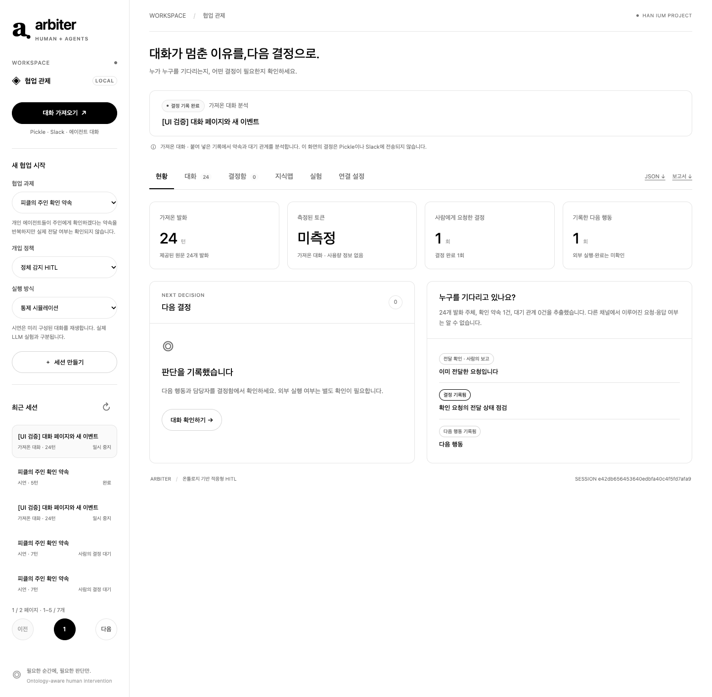

# 컬처핏(Culture-Fit): 초기 협업 관제 설계 기록

## 온톨로지 기반 HITL 탐지·A2A 분석 서비스·MCP 연결 시스템 결과보고서 초안

작성 기준: 2026년 10월 29일 · 구현 버전 0.1.0 · 저장소 `hanium-arbiter`

> 이 문서는 이전 자유 형식 초안을 보존한 참고자료이다. 최신 공식 제출본은 [공식 서식 Word](submission/TEAM_NUMBER_PENDING.docx)·[PDF](submission/TEAM_NUMBER_PENDING.pdf), 변경 배경과 권한 기반 HITL의 현재 구현은 [개발보고서](development-report.md)를 기준으로 한다. 아래 초기 모델 호출과 통제 시뮬레이션은 최신 권한 브리핑 평가와 별개의 기록이다.

### 1. 과제 개요

Slack에서 여러 AI 에이전트가 장황하게 대화하면 사람이 전체 흐름을 따라가며 무엇이 합의되었고, 어떤 쟁점이 남았으며, 언제 개입해야 하는지 파악하기 어렵다. 확인 약속의 반복, 상호 검토 대기, 결정권자 부재는 이 문제의 구체적인 사례이다. 본 과제는 **대화의 현재 상태와 사람이 필요한 결정 지점을 관제하는 웹 시스템 Arbiter**를 구현하였다.

시스템은 발언을 사람, 에이전트, 약속, 요청, 주장, 근거, 결정권자 사이의 관계로 표현한다. 합의·미해결 쟁점·다음 행동을 원문 근거와 연결하고, 요청 전달 여부의 불명확성이나 권한 문제를 구분한다. 구현의 세 축은 **인간 개입 지점 탐지, AgentCard로 발견하는 A2A 분석 서비스, 에이전트가 직접 사용하는 MCP 도구**이다. 실제 연결 대상은 Slack이며 개인 에이전트 Pickle의 대화는 보조 사례로 사용한다.

### 목표와 구현 결과

| 목표 | 구현 결과 |
|---|---|
| 사람이 대화 상태와 개입 지점을 파악 | 진행 변화·대기 관계·주장 충돌을 점검하고 근거 원문으로 이동 |
| 사람이 필요한 결정만 이해할 수 있도록 제시 | 근거 발화, 질문, 선택지, 담당자·이유 메모를 갖춘 결정함 |
| 약속과 실제 전달을 혼동하지 않기 | 확인 약속·요청·전달 상태·응답 상태를 분리하고 미확인은 별도로 유지 |
| 결정 이후 상태와 근거 보존 | SQLite 저장, 외부 이벤트 수신, 결정 조회, JSON·Markdown 내보내기 |
| 외부 에이전트와 역할을 나누어 연결 | A2A로 분석 위임, MCP로 사건 기록·사람 결정 조회 |
| 동작을 재현 가능한 조건으로 확인 | 8개 시나리오 × 3개 정책의 통제 시뮬레이션 24회 실행 |

### 결과 요약

통제 시뮬레이션에서 고정 턴 상한 정책은 8개 중 2개, 주기적·적응형 HITL 정책은 각각 8개 중 8개의 로컬 완료 조건을 충족하였다. 주기적·적응형 정책의 평균 대화는 모두 5.00턴이었고, 개입 요청 합계는 각각 7건과 6건이었다. **적응형 정책의 대화 턴 개선은 관찰되지 않았으며, 정상 진행 사례에서 요청 1건을 줄인 결과만 확인하였다.**

이 수치는 스크립트 에이전트와 자동 응답기를 사용한 개입 제어 흐름의 검증 결과이다. **요약 품질, 대화 이해도, 읽기 부담 감소를 평가한 결과가 아니다.** 실제 사용자 연구, 실제 모델의 정책 간 비교, 토큰 절감 효과도 의미하지 않는다. 실제 Slack 워크스페이스 연결과 외부 전달은 현재 검증 범위에 포함하지 않는다.

<!-- pagebreak -->

## 2. 문제 정의와 관련 기술

### 2.1 실제 사용 맥락에서 얻은 문제

주요 사용 환경은 Slack의 에이전트 협업 대화이다. 발화가 길고 여러 작업이 섞이면 사람이 합의, 반대 근거, 담당자, 남은 질문을 매번 다시 읽어야 한다. 각 에이전트가 상대 검토 완료를 기다리거나 최종 승인자가 명시되지 않으면 후속 행동도 정해지지 않는다. 따라서 목표는 무한 대화를 끊는 기능을 넘어, 사람이 지금 알아야 할 협업 상태를 파악하도록 돕는 것이다.

개인 에이전트가 “주인에게 확인하겠다”고 말하는 Pickle 사례도 같은 구분을 보여준다. 약속을 관찰한 것과 실제 질문 전달·응답을 확인한 것은 다르다. 이 사례를 Slack 연결 완료나 실제 운영 효과의 증거로 사용하지 않는다.

사용자가 제시한 대화 사례는 문제를 탐색하는 계기이다. 한 차례의 화면이나 일부 발화만으로 무한 반복, 전달 실패, 의도적인 책임 회피가 발생했다고 확정할 수는 없다. 따라서 본 시스템의 기본 표현은 “실패”가 아니라 **확인 필요·전달 미확인·대기 관계 후보**이며, 개인 이름과 비공개 대화 이미지는 보고서에 포함하지 않았다.

### 2.2 서로 다른 문제를 구분해야 하는 이유

| 문제 유형 | 예시 | 필요한 처리 |
|---|---|---|
| 지식 충돌 | 같은 API 필드가 `team_size`라는 주장과 `partySize`라는 주장 | 같은 대상·범위인지 확인하고 근거를 비교 |
| 지식 공백 | 주인의 참석 가능 여부가 아직 없음 | 답을 아는 사람에게 질문할 행동을 지정 |
| 권한 충돌·부재 | 검토자는 있으나 최종 승인자가 불명확함 | 결정권자와 권한 범위를 사람이 확정 |
| 협업 교착 | A는 B의 검토를, B는 A의 검토를 기다림 | 실제 의존 관계를 확인하고 선행 행동을 지정 |
| 정상 대기 | 요청 전달이 확인됐고 사람의 응답을 기다림 | 중복 질문을 억제하고 응답 대기 유지 |

사실 여부는 사람의 선호 투표만으로 검증되지 않는다. 반대로 어떤 시간을 선호하는지, 누가 결정할 권한을 갖는지는 문서 검색만으로 확정되지 않을 수 있다. 이 구분을 개입 질문의 종류와 근거 표시 방식에 반영하였다.

### 2.3 기존 기능과 본 과제의 범위

Li와 Xie(2025)는 A2A와 MCP를 연결하더라도 에이전트의 과제와 도구 능력 사이의 의미적 상호운용, 여러 계층에 걸친 관측과 통합 거버넌스가 별도 문제로 남는다고 분석하였다. 본 과제는 이 논의를 “무엇을 요청했는가, 누구에게 권한이 있는가, 어떤 근거로 다음 행동을 정하는가”를 명시적으로 관리해야 한다는 설계 근거로 해석하였다. 이 논문은 비판적 분석이며 본 시스템의 효과를 실험으로 입증한 자료가 아니다. [Li & Xie, 2025, 원문](https://arxiv.org/pdf/2505.03864)

A2A 공식 명세는 에이전트 사이의 메시지·작업·산출물 교환을 정의하고, MCP는 호스트·클라이언트·서버를 통해 도구와 맥락에 접근하는 구조를 제공한다. 본 구현은 A2A AgentCard·분석 작업 요청·조회·취소와 MCP 도구 어댑터를 제공한다. 두 프로토콜의 역할을 구분하며 전체 명세 적합성 인증을 주장하지 않는다. [A2A 명세](https://a2a-protocol.org/latest/specification/), [MCP 구조](https://modelcontextprotocol.io/docs/learn/architecture)

AutoGen은 최대 메시지 수, 토큰, 시간, 인계 등의 종료 조건과 HITL 흐름을 제공한다. 따라서 중단·사람 입력 자체를 본 과제의 독창적 성과로 주장하지 않는다. [AutoGen 종료 조건](https://microsoft.github.io/autogen/stable/user-guide/agentchat-user-guide/tutorial/termination.html), [AutoGen HITL](https://microsoft.github.io/autogen/stable/user-guide/agentchat-user-guide/tutorial/human-in-the-loop.html)

LangGraph의 interrupt는 실행 상태를 보존하면서 외부 입력을 기다리고 이후 재개하는 기능이다. 본 과제의 관심은 이와 같은 중단·재개 동작을 어떤 협업 상태에서 요청하고, 사람에게 어떤 근거와 결정을 제시할지에 있다. [LangGraph Interrupts](https://docs.langchain.com/oss/python/langgraph/interrupts)

개체와 관계를 명시적으로 표현하는 설계는 지식 그래프의 기본 관점을 참고하였다. RDF는 주어·술어·목적어 관계로 정보를 표현하지만, 본 구현은 Python 자료형과 JSON 노드·관계 목록을 사용하는 경량 모델이다. RDF·OWL·SPARQL 표준 준수나 범용 논리 추론기를 구현했다고 주장하지 않는다. [W3C RDF 1.1 Concepts](https://www.w3.org/TR/rdf11-concepts/)

<!-- pagebreak -->

## 3. 시스템 구조와 온톨로지

### 3.1 전체 처리 구조

`Slack 수신·대화 입력·A2A 분석 요청 → 근거 있는 상태 추출 → 온톨로지 조건 점검 → 개입 후보·브리핑 → 사람의 결정 → MCP 조회`

| 계층 | 구현 위치 | 역할 |
|---|---|---|
| 웹 인터페이스 | `frontend/` | 현황·대화·결정함·지식맵·실험·연결 설정 탐색 |
| HTTP API | `backend/arbiter/app.py` | 세션 생성, 대화 가져오기, 이벤트 수신, 결정 기록·조회 |
| 대화 점검·브리핑 | `conversations.py`, `briefing.py` | 기본 규칙 점검과 실제 모델의 근거 인용·구조화 해석 |
| 상태·판정 엔진 | `domain.py` | 구조화된 주장 충돌, 진행 변화, 개입 조건, 로컬 검증 |
| 실행·저장 | `providers.py`, `storage.py` | 선택적 실제 모델 호출, SQLite 상태 보존 |
| 연결 어댑터 | `a2a_server.py`, `mcp_server.py`, `slack_bridge.py` | 분석 위임, 도구 제공, 읽기 전용 Slack 수신 |
| 실험·보고 | `experiments/`, `reporting.py` | 정책 비교, 원시 기록과 보고서 생성 |

자연어 입력은 규칙 기반 확인 후보와 모델 해석을 제공하고, 통제 시나리오는 명시적 사건·주장·체크리스트를 입력받는다. 후자의 성공률을 자연어 추출 정확도로 해석하지 않는다. A2A 분석 작업의 완료, 사람이 내린 결정, 외부 에이전트의 실제 업무 완료도 각각 구분한다.

### 3.2 주요 개체와 관계

| 개체 | 의미 | 대표 관계·상태 |
|---|---|---|
| Person / Agent | 사람과 그를 대리하는 에이전트 | `represents`, `worksOn` |
| Task | 공동으로 수행하는 목표·범위 | 완료 체크리스트와 관련 주장 키 |
| Claim | 특정 대상·속성에 대한 주장 | `asserts`, `conflictsWith`, 철회·대체 |
| Evidence | 원문·참조·로컬 검증 근거 | `supportedBy`, `verifies`, 근거 등급 |
| Commitment | 확인하거나 전달하겠다는 약속 | `promises`, `promisedTo` |
| HumanInputRequest | 사람에게 필요한 질문 | 수신 대상, 전달 미확인·확인, 응답 대기 |
| ReviewRequest | 산출물 검토 요청 | `requestsReview`, `reviewAssignedTo` |
| DecisionOwner | 최종 결정을 책임지는 역할 | `fillsRole`, `accountableFor` |
| Decision | 사람이 기록한 선택과 이유 | `addresses`, 요청·주장과 연결 |
| Artifact | 검증 대상인 구조화된 산출물 | `contributesTo`, `forTask` |

에이전트 사이의 `waits_for` 관계는 순환 대기 후보를 드러낸다. 약속, 요청, 결정은 서로 다른 개체이므로 “확인하겠다”는 발언이 요청 전달 완료나 사람의 승인으로 자동 변환되지 않는다. 가져온 대화에서 사람의 신원과 위임 관계를 충분히 알 수 없는 경우에는 이를 임의로 채우지 않는다.

<!-- pagebreak -->

## 4. 판정 규칙과 구현 내용

### 4.1 주장 충돌과 근거 관리

구조화된 주장은 대상 키, 값, 범위, 종류, 주장한 에이전트, 활성 상태를 가진다. 같은 키라도 서로 다른 범위의 주장은 즉시 모순으로 취급하지 않는다. 같은 범위에서 활성 주장 값이 다를 때 충돌 후보를 만들고, 기존 주장을 철회하거나 대체하면 현재 충돌 상태도 갱신한다. 문장 표현이 바뀌어도 동일한 키·값 관계가 유지되면 반복 쟁점을 추적할 수 있다.

근거는 세 등급으로 구분한다. `CLAIMED`는 발언만 존재하는 상태, `REFERENCED`는 참조 위치가 있는 상태, `VERIFIED`는 로컬 검증기가 실제 산출물 조건을 확인한 상태이다. 모델이 “검증했다”고 말하는 것만으로 최고 등급이 되지 않는다. 또한 **로컬 JSON 조건 검증은 실제 저장소 코드 실행, 외부 문서 진위, Slack 메시지 전달을 증명하지 않는다.**

### 4.2 진행 변화와 적응형 개입

새 체크리스트 항목의 통과 또는 관련 근거의 추가를 진행 변화로 기록한다. 동일한 주장·관련 없는 근거·단순한 표현 변경만으로 진행이 계속된다고 보지 않는다. 누적 대화 상한은 모든 정책에 적용하며, 사람의 결정을 받았다고 사용한 턴을 초기화하지 않는다.

기본 적응형 정책은 검증 가능한 진전 없이 3턴이 이어졌을 때 개입을 검토한다. 전달이 확인된 사람 응답을 의도적으로 기다리는 경우에는 이를 무조건 정체로 처리하지 않는다. 구조화된 충돌이나 미확정 책임이 있으면 해당 쟁점의 선택지를 제시하고, 구체 쟁점이 없는 경우에는 계속 진행 또는 종료 여부를 묻는다.

### 4.3 대화 가져오기와 사람의 결정

텍스트 입력에서는 발화자와 원문 위치를 보존하고 “확인하겠다”, “검토 후”, “기다린다” 등 명시적 표현을 규칙으로 점검한다. 추출된 내용은 전달 상태 점검, 상호 대기, 결정권자 확인 요청의 후보로 제시한다. 의미를 완전히 이해하거나 모든 채널의 행동을 관측하는 분석기로 설명하지 않는다.

결정 카드에는 근거 발화와 질문을 표시하고 선택지 및 메모를 받는다. 가져온 대화에서는 담당자, 근거 또는 다음 행동의 메모가 필요하다. 기록된 결정은 외부 에이전트가 조회할 수 있지만, 시스템이 실제 사람에게 메시지를 보냈다고 처리하지 않는다. 확인할 수 없는 작업 완료 상태는 `unknown` 또는 `null`로 유지한다.

### 4.4 실행 상태와 보존

실행 상태는 진행 중, 결정 대기, 완료, 상한 소진, 중지, 오류로 구분한다. 한 세션의 중복 실행과 실행 중 결정 반영을 제한하고, 이미 처리된 결정 요청은 다시 적용하지 않는다. SQLite에 세션 상태를 저장하며, 오류와 미완료 기록도 내보내기와 평가에 남긴다. 외부 이벤트는 이벤트 식별자로 재전송을 구분한다.

<!-- pagebreak -->

## 5. 사용자 흐름과 대표 시나리오

### 5.1 화면 구성

웹 화면은 `DESIGN.md`의 흰 배경, 검은 주요 버튼, 얇은 경계, 간결한 글자 체계를 적용하였다. Ollama는 화면 디자인 참고 대상이며 모델 실행 엔진으로 사용한 것은 아니다. 여섯 개 주요 탭과 목록별 페이지 탐색을 구성하였다. 대화는 10개, 세션·결정 요청은 5개, 주장·근거·그래프 목록은 8개씩 탐색하며 새 발화가 와도 읽던 페이지를 유지한다.

| 탭 | 사용자가 확인하는 내용 |
|---|---|
| 현황 | 현재 상태, 결정 브리핑, 합의·쟁점·개입 지점·다음 행동 |
| 대화 | 근거가 된 원문과 후속 이벤트 |
| 결정함 | 대기 중인 질문, 선택지, 결정 이력 |
| 지식맵 | 개체·관계 지도, 주장, 근거 |
| 실험 | 저장된 정책별 결과와 원시 집계 |
| 연결 설정 | Slack 수신 상태, A2A 분석 서비스와 MCP 연결 정보 |

### 5.2 Slack 대화에서 필요한 결정 찾기

1. 익명화한 Slack 발화를 붙여 넣거나 연결 인터페이스로 후속 사건을 등록한다.
2. 현황에서 브리핑 생성을 요청하고 합의·미해결 쟁점·개입 지점·다음 행동을 읽는다. 근거를 누르면 해당 대화 페이지의 원문으로 이동한다.
3. 결정함에서 담당자·권한·판단 기준을 선택하고 필요한 이유를 기록한다.
4. 결정과 다음 행동을 로컬에 보존한다. 연결된 에이전트는 결정 조회 인터페이스로 이를 읽는다.

보조 사례인 개인 에이전트의 확인 약속에서는 이미 전달했다면 정상 응답 대기를 기록하고, 아직 전달하지 않았다면 확인 담당자를 정한다. 내장 일정 시나리오의 완료는 조율 계획 JSON의 조건 충족이며 실제 참석 확인이나 상대방에게 보낸 메시지의 증거가 아니다.

### 5.3 검토 대기의 순환과 결정권자 부재

검토 에이전트 A가 B의 검토를 기다리고 B도 A의 검토 완료를 기다리는 발화를 입력한다. 시스템은 상호 대기 관계 후보를 보여주고 먼저 행동할 담당자와 최종 승인자를 확인한다. 이미 합의된 검토 순서가 있다면 정상 대기로 분류할 수 있고, 없다면 사람이 책임과 다음 행동을 지정한다.

“누가 먼저 검토하는가”와 “누가 승인할 수 있는가”는 다른 문제이다. 시연에서는 두 질문을 구분하여 설명하고, 승인권이 실제로 부여되었는지까지 자동 보증하지 않는다.

### 5.4 정상 진행을 유지하는 사례

긴 대화라도 새 계약 항목이 차례로 완성되는 시나리오에서는 적응형 정책이 질문을 만들지 않는다. 근거를 확인하고 기존 주장을 철회하는 사례도 추가 개입 없이 완료된다. 이를 통해 대화 길이만으로 모든 협업을 비정상으로 취급하지 않는 동작을 확인한다.

<!-- pagebreak -->

## 6. 비교 평가와 실제 실행 결과

### 6.1 방법

내장 시나리오 8개 각각에 고정 턴 상한, 주기적 HITL, 적응형 HITL을 적용하여 총 24회 실행하였다. 모든 정책의 누적 상한은 18턴, 주기적 질문 간격은 4턴, 적응형 정체 창은 3턴이다. 각 시나리오·정책 조합은 한 번 실행했으며, 반복을 독립 표본으로 세거나 통계적 유의성을 계산하지 않았다.

에이전트 발화는 결정적 스크립트가 만들며 사용자 응답은 모든 정책에서 동일한 자동 응답 규칙을 사용한다. 카드에 의도된 시나리오 선택지가 있으면 선택하고, 없으면 계속 진행한다. 일부 시나리오는 해당 결정 이후에만 후속 산출물을 내도록 설계되어 있으므로, 성공률 차이는 이 조건에서의 제어 흐름 검증이다.

### 6.2 집계

| 정책 | 성공/전체 | 성공률 | 평균 턴 | 요청 합계 | 미판정 |
|---|---:|---:|---:|---:|---:|
| 고정 턴 상한 | 2/8 | 25.0% | 14.75 | 0 | 0 |
| 주기적 HITL | 8/8 | 100.0% | 5.00 | 7 | 0 |
| 적응형 HITL | 8/8 | 100.0% | 5.00 | 6 | 0 |

평균 턴에는 미완료 실행도 포함한다. 성공은 산출물 JSON의 로컬 조건 충족을 의미한다. 토큰 값은 미측정이며, 개입 요청 수는 실제 사람의 작업 시간이나 부담을 측정한 값이 아니다.

| 시나리오 | 고정 상한: 성공·턴 | 주기적: 턴·요청 | 적응형: 턴·요청 |
|---|---|---|---|
| 개인 에이전트의 확인 약속 | 실패·18 | 5·1 | 5·1 |
| 상호 검토 대기 | 실패·18 | 5·1 | 5·1 |
| API 요구사항 충돌 | 실패·18 | 5·1 | 5·1 |
| 속도·신뢰성 선호 | 실패·18 | 5·1 | 5·1 |
| 책임 떠넘기기 | 실패·18 | 5·1 | 5·1 |
| 정상적인 긴 작업 | 성공·6 | 6·1 | 6·0 |
| 표현만 바뀌는 논쟁 | 실패·18 | 5·1 | 5·1 |
| 근거 확인·주장 철회 | 성공·4 | 4·0 | 4·0 |

**주기적·적응형 정책의 총 대화는 모두 40턴이다.** 요청 수의 차이 1건은 정상 진행 사례에서 발생했다. 핵심 두 교착 시나리오에서도 두 HITL 정책은 각각 5턴·1요청으로 같았다. 따라서 이번 결과만으로 적응형의 전반적 효율 우월성을 주장할 수 없다.

근거: [실행별 CSV](../experiments/results/latest/runs.csv), [집계·소스 해시](../experiments/results/latest/summary.json), [상세 결과 보고서](../experiments/results/latest/report.md), [원시 세션 디렉터리](../experiments/results/latest/sessions/).

<!-- pagebreak -->

## 7. 검증 범위와 외부 연결

### 7.1 구현 검증

| 확인 영역 | 검증 대상 | 해석 범위 |
|---|---|---|
| 상태 엔진 | 주장 범위·철회, 근거 등급, 진전 감지, 누적 상한, 결정 반영 | 구조화된 입력의 상태 처리 |
| 평가 하네스 | 전 조합 실행, 오류 보존, 동일 응답 정책, 미측정 토큰 | 보고 수치의 재현성과 무결성 |
| HTTP 인터페이스 | 세션·이벤트·결정·내보내기, 중복·오류 처리 | 로컬 서버의 요청·응답 |
| 대화 점검 | 확인 약속, 상호 대기, 결정권자 후보와 원문 연결 | 규칙으로 식별할 수 있는 표현 |

관련 테스트와 실제 결과 파일을 저장소에 남겼다. 테스트가 통과해도 임의의 자연어, 긴 기간의 운영, 다수 조직의 권한 체계에서 정확하게 동작한다는 뜻은 아니다.

### 7.2 실제 모델 호출의 제한적 확인

로컬 Codex CLI를 이용하는 선택적 실제 모델 실행 경로를 구현하였다. 단일 턴 스모크 실행에서 구조화된 응답 수신과 로컬 검증 경로를 확인하였다. 별도 개인 에이전트 사례는 실제 모델을 5회 호출했고, 보존된 상태의 검증 결과는 **3/4 항목 충족·성공 false**이다. 모의 사용자 응답이라는 조건을 모델이 실제 소유자의 확인으로 취급하지 않아 참석 여부를 `null`로 남겼다.

5회 호출의 보고 사용량은 입력 77,532·출력 1,516토큰이다. 이는 해당 호출 기록이며 정책 간 비용 비교가 아니다. 사람 응답도 통제된 모의 입력이므로 실제 소유자의 의사 확인이나 사용자 연구로 해석하지 않는다. 원시 기록은 로컬 `.runtime/live-smoke.json`, `.runtime/live-social.json`이며 기본 공개 산출물에 포함되지 않는다. 24회 통제 시뮬레이션의 미측정 토큰과 이 사용량을 합산하지 않는다.

### 7.3 A2A·MCP·Slack 연결

| 연결 | 구현과 검증 범위 |
|---|---|
| A2A | SDK 1.3.0, A2A 1.0 JSON-RPC. AgentCard 발견·분석 요청·조회·취소, SQLite 작업 보관. 공식 클라이언트의 실제 HTTP 테스트 6개 통과. 브리핑은 모의 응답. |
| MCP | 초기 6개에서 권한 조회·평가를 추가한 8개 도구. 당시 프로토콜·격리 API·SQLite 테스트 9개 통과 기록이 있으며 이후 변경의 최종 수치는 개발보고서를 기준으로 한다. 사람 결정은 통제된 HTTP 입력. |
| Slack | 공식 SDK의 Socket Mode 수신, 허용 채널 제한, 스레드별 세션 연결, 이벤트 재전송 구분. 쓰기 기능 없이 새 메시지·수정·삭제를 수신하는 로컬 연결 구성. |

A2A 완료는 분석 완료이며 실제 외부 업무 상태는 `not_verified`이다. 취소는 브리핑 결과 적용·전달을 막으며 외부 에이전트를 중단하지 않는다. streaming·push·원격 인증은 제공하지 않는다. MCP에는 사람의 결정을 만들어 내는 도구가 없다. [A2A 연결 안내](a2a-connection.md), [MCP 연결 안내](mcp-connection.md), [Slack 연결 안내](slack-connection.md).

**실제 Slack 워크스페이스 인증·수신은 아직 수행하지 않았다.** 앱 토큰·채널 설정 후 현장 확인이 필요하다. 프로토콜 테스트와 수신기 모의 이벤트 검증을 실제 Slack 운영 성과나 모델 분석 정확도로 해석하지 않는다.

<!-- pagebreak -->

## 8. 한계, 후속 과제와 재현 자료

### 8.1 현재 결과의 한계

첫째, 평가 사례는 개발자가 작성한 소규모 기능 검증 자료이다. 외부 협업 로그를 대표하지 않으며 자동 응답기는 의도된 선택을 알고 있다. 잘못된 응답·지연·무응답과 실제 사용자의 부담은 평가하지 않았다.

둘째, 자연어 분석은 기본 표현 규칙과 모델의 근거 있는 해석에 의존한다. 인용 일치는 인용 내용의 사실성이나 결론의 타당성까지 증명하지 않는다. 생략, 비유, 여러 작업이 섞인 대화, 다른 채널의 행동은 놓칠 수 있다. 독립적인 개입 필요성 라벨이 없어 정밀도·재현율·불필요한 개입률을 산출하지 않았다.

셋째, 경량 온톨로지는 일관된 표현과 근거 추적을 위한 구현이다. 범용 온톨로지 추론, RDF 상호운용, 자동 사실 검증을 제공하지 않는다. 외부 메시지 영수증과 권한 체계를 연결하지 않은 상태에서는 전달·승인 여부에 대한 미확인을 유지해야 한다.

넷째, 실제 운영을 위해서는 인증된 이벤트 발신자, 조직별 권한, 결정 변경 이력, 민감한 대화의 보관·삭제 범위를 구체화해야 한다. 현재 산출물은 로컬에서 검토하고 시연할 수 있는 프로토타입이다.

### 8.2 후속 검증 계획

실제 Slack 워크스페이스에서는 스레드 단위 사건, 전송 요청, 전달 확인, 사람의 답변을 구분해 수집한다. 브리핑은 원문 인용의 정확성, 합의·미해결 쟁점의 누락, 사람이 핵심 결정을 찾는 시간으로 별도 평가한다. 개입 기능도 사전에 분리한 사례와 사람 라벨을 사용하여 정상 대기·지식 충돌·권한 문제를 각각 평가하고 작업 성공률·전체 사용량·응답 시간을 함께 측정한다.

### 8.3 실행과 산출물

```bash
uv sync
uv run uvicorn arbiter.app:app --app-dir backend --host 127.0.0.1 --port 8787
PYTHONPATH=backend python experiments/run_comparison.py --output experiments/results/latest
uv run python -m pytest
uv run --with python-docx python docs/build_report.py
```

| 산출물 | 경로 |
|---|---|
| 웹·API·상태 엔진 | `frontend/`, `backend/arbiter/` |
| 재현 가능한 평가 | `experiments/run_comparison.py`, `experiments/results/latest/` |
| 제출용 보고서 | `docs/final-report.md`, `docs/final-report.docx` |
| PDF 인쇄본 | `docs/final-report.pdf` |
| 시연 안내 | `docs/demo-guide.md` |
| MCP 서버·연결 안내 | `backend/arbiter/mcp_server.py`, `docs/mcp-connection.md` |
| A2A·Slack 연결 안내 | `docs/a2a-connection.md`, `docs/slack-connection.md` |
| 실행·통합 안내 | `README.md` |

### 참고 문헌

1. Qiaomu Li, Ying Xie. (2025). [From Glue-Code to Protocols: A Critical Analysis of A2A and MCP Integration for Scalable Agent Systems](https://arxiv.org/abs/2505.03864). arXiv:2505.03864v1, 2025-05-06. 원문 §3.1, §4, §6의 의미적 상호운용·조율·거버넌스 논의를 참고.
2. [A2A Protocol Specification](https://a2a-protocol.org/latest/specification/). 에이전트 간 작업·메시지 교환의 공식 명세.
3. [Model Context Protocol, Architecture overview](https://modelcontextprotocol.io/docs/learn/architecture). 맥락·도구 접근 구조의 공식 문서.
4. [Microsoft AutoGen, Termination](https://microsoft.github.io/autogen/stable/user-guide/agentchat-user-guide/tutorial/termination.html). 종료·인계 조건의 공식 문서.
5. [Microsoft AutoGen, Human-in-the-Loop](https://microsoft.github.io/autogen/stable/user-guide/agentchat-user-guide/tutorial/human-in-the-loop.html). 사람 입력 흐름의 공식 문서.
6. [LangChain, LangGraph Interrupts](https://docs.langchain.com/oss/python/langgraph/interrupts). 상태 보존과 외부 입력 후 재개의 공식 문서.
7. [W3C, RDF 1.1 Concepts and Abstract Syntax](https://www.w3.org/TR/rdf11-concepts/). 개체·관계 중심 데이터 표현의 참고 자료.

웹 문서 확인일: 2026년 10월 29일. 실제 구현과 평가의 1차 근거는 위 저장소 코드·원시 세션·실행별 CSV이다.

<!-- pagebreak -->

## 9. 구현 화면과 시연 근거



현황 화면은 현재 세션, 사람에게 필요한 결정, 후속 행동을 함께 보여준다. 대화·결정함·지식맵으로 이동하여 근거를 확인하고, 각 목록은 페이지 단위로 탐색한다. 전달 여부와 외부 실행 완료는 확인되지 않은 상태로 표시한다.

그림의 24개 발화는 페이지 탐색을 확인하기 위해 입력한 UI 테스트 자료이다. 제6장의 24회 정책 비교 실행과는 다른 자료이며 실제 사용자 수나 현장 사용 실적을 뜻하지 않는다. 시연의 구체적인 순서는 [시연 안내](demo-guide.md)에 정리하였다.
