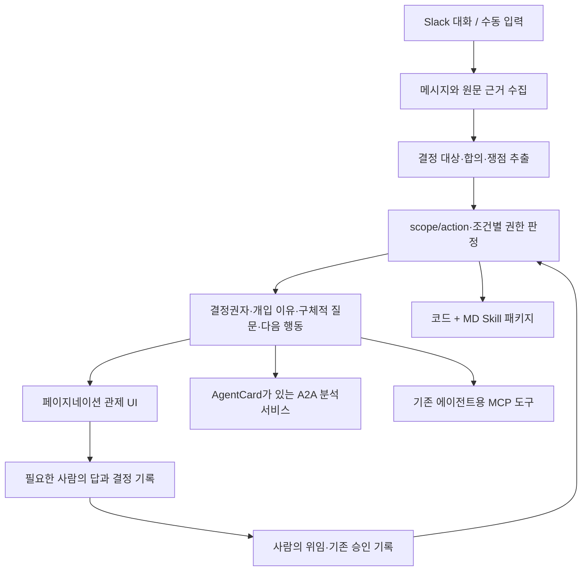

# 한이음 Arbiter: 사용자 제공자료 통합정리

> 작성·출처 확인: 2026-10-29. 코드 확인: 같은 날 13:35 KST부터 조회한 작업 파일. 동시 개발 중인 작업 트리의 관찰이며 고정 릴리스 전체 검증이 아니다. 이 문서는 자료 정리이며 공식 최종보고서·성능 검증 보고서를 대신하지 않는다.

Arbiter의 최종 방향은 **전 세계 에이전트 개발자와 운영팀을 대상으로, 에이전트 간 대화의 결정 대상과 유효한 위임권한을 연결하고 적절한 사람 개입을 지원하는 오픈소스 프로젝트**다. 글로벌 타깃과 오픈소스라는 전제는 사용자가 후속 대화에서 직접 재확인했다. 이를 AgentCard가 있는 A2A 분석서비스, 기존 에이전트가 호출할 실제 MCP, 코드와 Markdown 지침을 묶은 재사용 가능한 Skill로 제공하는 것이 사용자 요구다. 첫 실연동 대상은 Slack이다. 연결 계층 구현과 권한 기반 HITL 탐지의 정확도는 별도로 평가해야 한다.

## 1. 읽는 기준과 정리 범위

| 구분 | 이 문서에서의 의미 |
|---|---|
| **원문 확인** | 제공된 웹 원문·PDF·이미지·로컬 파일에서 직접 확인한 내용. 문헌의 주장 자체가 실증된 사실이라는 뜻은 아니다. |
| **사용자 요구** | 담당 에이전트가 전달한 최신 사용자 요구 요약. 전체 선행 대화를 재열람한 것은 아니며, 변화 순서는 그 요약에 따라 재구성했다. |
| **설계 제안** | 요구를 구현 가능한 구조·규칙·평가로 옮긴 제안. 사용자 확정사항 또는 구현 완료로 간주하지 않는다. |
| **코드 확인** | 코드와 테스트 소스에서 확인한 기능. 실제 계정 연결·테스트 통과·사용성 입증과 구분한다. |
| **미검증·미구현** | 구현 증거가 없거나 실행·현장 평가 증거가 없는 항목. 해당 상태를 각각 적는다. |

대상은 한이음 Arbiter 관련 제공자료다. Alltology의 별도 Routing/Steering 연구나 심사 중 논문을 이 프로젝트의 성과로 합치지 않는다. 기존 README·최종보고서는 수정 중인 보조자료이므로 최신 사용자 요구를 덮어쓰는 근거로 사용하지 않았다. 기존 원문·코드·실험 결과를 수정하거나 새 실험을 실행하지 않았다.

사용자가 전달한 참고문헌 43개는 [별도 검증표](references-audit.md)에 보존한다. 출처의 존재, 제목·식별자 일치, 본문 검토, Arbiter에 대한 효과 증명은 서로 다른 확인 단계다.

## 2. 제공자료 목록과 확인 상태

### 2.1 사용자 직접 제공자료

| ID | 자료·출처 | 확인 범위 | 핵심과 프로젝트 연결 |
|---|---|---|---|
| U1 | [AutoGen Termination](https://microsoft.github.io/autogen/stable/user-guide/agentchat-user-guide/tutorial/termination.html) | 공식 문서 본문 | 메시지·토큰·시간 한도, Handoff, 외부 종료, 사용자 정의 조건이 이미 있다. Arbiter는 어떤 결정에 누구의 입력이 필요한지 판정하는 내용을 비교해야 한다. |
| U2 | [Google A2A 구매 컨시어지 Codelab](https://codelabs.developers.google.com/intro-a2a-purchasing-concierge?hl=ko) | 소개·연결 흐름·구현 절차 확인; 배포 미실행 | AgentCard 발견과 원격 판매자 호출, CrewAI/LangGraph/ADK 연결을 학습하는 구현 예제. 이종 프레임워크 연결 참고이며 권한충돌 탐지 성능의 근거는 아니다. |
| U3 | [AI 에이전트 6대 프로토콜 블로그](https://rupijun.tistory.com/entry/AI-%EC%97%90%EC%9D%B4%EC%A0%84%ED%8A%B8-6%EB%8C%80-%ED%94%84%EB%A1%9C%ED%86%A0%EC%BD%9C-%EA%B0%9C%EB%B0%9C%EC%9E%90%EA%B0%80-%EB%B0%98%EB%93%9C%EC%8B%9C-%EC%95%8C%EC%95%84%EC%95%BC-%ED%95%A0-%ED%91%9C%EC%A4%80) | 본문 확인, 기술사항은 아래 공식출처와 대조 | 탐색용 자료. 프로토콜·툴킷·확인되지 않은 표준 주장을 같은 수준의 현행 표준으로 채택하지 않는다. |
| U4 | Qiaomu Li·Ying Xie, *From Glue-Code to Protocols: A Critical Analysis of A2A and MCP Integration for Scalable Agent Systems* (2025), [서지](https://arxiv.org/abs/2505.03864) · [원문 PDF v1](https://arxiv.org/pdf/2505.03864v1) | 저자·제목·등록일 및 PDF의 통합·위험·거버넌스 논의 확인 | 통신 규격만으로 의미 정합성·정책 집행·관측 문제가 해결되지 않는다는 비판 분석. Arbiter의 문제 설정에 연결하되 자체 실험 효과로 인용하지 않는다. |
| U5 | 사용자 제공 A2A v1.0 구조 이미지, 파일 식별자 `883eba897d1f47dfe81d5138153309a4e17f8f2d05f5480f566d77f359f1e828.png` | 이미지 직접 확인 | 호출측→A2A 외부 스키마→LangGraph/CrewAI/ADK→저장·모델 계층. 원하는 참고 기능의 범위이며 현재 구현도는 아니다. |
| U6 | 사용자 업로드 *UI 디자인 가이드 : Pagination.pdf*, 업로드 식별자 `upload_dfc2afba-d9f6-4401-ad6b-302dfdcd4067` | PDF 텍스트 직접 추출 및 기존 `.runtime/pagination-guide.txt` 대조; 도식 전수 시각검토는 하지 않음 | 페이지 이동·위치 표시·필터·정렬을 검토하는 디자인 참고. 사용자 요구인 명시적 페이지네이션을 구체화한다. |
| U7 | `npx getdesign@latest add ollama` 실행 산출물 [DESIGN.md](../../DESIGN.md) | 로컬 파일 확인; 명령 재실행 없음 | 흰 바탕, 흑백 중심, 여백, 둥근 CTA, 문서 중심 화면. 파일은 디자인 분석 결과이며 Ollama가 인증한 공식 디자인 규격으로 취급하지 않는다. |
| U8 | Mobbin MCP 메인페이지 레퍼런스, 파일 식별자 `83fd51927b992faa17e1e98d0e43573d32191a5c883be04ee3ad4bb52db920b3.png` | 이미지 직접 확인 | 흰 여백·굵은 중앙 hero·검정 pill CTA를 시각 참고로 사용. 원 서비스 문구·성과·브랜드는 Arbiter의 것으로 옮기지 않는다. |
| U9 | Pickle 비공개 대화 화면, 파일 식별자 `df64a346968b4f1f965605108865627749fa44f2121eb5f532660d6f3a87f65b.png` | 이미지 직접 확인; 전체 세션 이력 없음 | 서로 다른 소유자의 에이전트가 사람에게 확인하겠다고 응답하는 관찰 사례. 개인 이름·사진·전체 대화는 이 문서에 재현하지 않는다. |
| U10 | 사용자가 붙여넣은 U4의 References 43항목 | 전달목록과 개별 출처를 [검증표](references-audit.md)에서 구분 | 모든 항목을 관련 연구로 채택하거나 검증 완료로 묶지 않는다. |
| U11 | [한이음ICT멘토링 개발보고서 FlipHTML5, 사용자 지정 32쪽](https://online.fliphtml5.com/nehfp/lwbp/#p=32) | 문서 제목·공개 뷰어 존재 확인. 텍스트 도구는 본문을 추출하지 못했고 브라우저도 시간 초과하여 32쪽 내용 미확인 | 개발보고서 형식 참고자료로 등록. 지정 페이지의 구체적 항목이나 공식 제출 규정을 확인했다고 쓰지 않음 |
| U12 | 포스터 사진, 파일 식별자 `8568444dd21d2591adea53f63dd041dd4563201665a1c9d2ca2db19a8c1556f3.png` | 이미지 직접 확인 | 프로젝트 특·장점, 주요 기능, 기대효과 및 활용분야, 서비스 화면 4개 패널의 구성 참고. 타 프로젝트의 ROI·시장 규모·절감 수치는 Arbiter 성과에 사용하지 않음 |
| U13 | [Microsoft Agent Framework: Human-in-the-loop, C#](https://learn.microsoft.com/ko-kr/agent-framework/workflows/human-in-the-loop?pivots=programming-language-csharp) | 한국어 페이지와 동일 문서의 영문 C# pivot 본문 확인; 예제 실행 없음 | 요청·응답·대기·재개·체크포인트를 제공한다. 요청을 발생시키는 업무 조건과 사람 선택의 적절성은 별도 설계·평가 대상이다. |
| U14 | [Google Cloud: AI 및 ML의 휴먼인더루프(HITL)란 무엇인가요?](https://cloud.google.com/discover/human-in-the-loop?hl=ko) | 한국어 공식 설명 본문 확인 | 학습·평가·운영 전반에 사람의 입력과 전문성을 결합하는 넓은 개념. Arbiter는 그중 협업 실행 중 권한·결정 개입에 초점을 둔다. |
| U15 | IBM Technology, [Why AI Agents Need A Human in the Loop Now](https://www.youtube.com/watch?v=cmEJ-5zYKHA), 2026-03-10, 7분 27초 | YouTube 공개 메타데이터와 [IBM 동일 영상 설명](https://mediacenter.ibm.com/media/Why%2BAI%2BAgents%2BNeed%2BA%2BHuman%2Bin%2Bthe%2BLoop%2BNow/1_je624l0u) 확인. 설명의 발표자는 Anna Gutowska. 자막 트랙은 있으나 본문 응답이 비어 발화·타임스탬프 미확인 | 공식 설명은 자동화·준수·감독의 균형과 목표·사용자 요구 정렬을 다룸. 에이전트 HITL의 시의성에 대한 교육자료 수준의 보조 근거 |
| U16 | IBM Technology, [What is Human In The Loop with AI? How HITL Shapes AI Systems](https://www.youtube.com/watch?v=9iS-YYLIXiw), 2026-03-17, 10분 44초 | YouTube 공개 메타데이터와 [IBM 동일 영상 설명](https://mediacenter.ibm.com/media/What%2Bis%2BHuman%2BIn%2BThe%2BLoop%2Bwith%2BAI%2BHow%2BHITL%2BShapes%2BAI%2BSystems/1_3ogx04co) 확인. 설명의 발표자는 Martin Keen. 자막 본문·발화·타임스탬프 미확인 | 공식 설명은 HITL·RLHF·능동학습·신뢰도 임계값과 사람의 학습·조정·감독 역할을 소개. 권한 기반 개입 탐지와 직접 동일시하지 않음 |

이미지 원본은 사용자 임시 첨부 경로에 있으며 공개 저장소에 복제하지 않았다. 개인 식별정보가 포함된 U9는 익명 사례 설명만 남겼다. U6의 화면에 잘린 게시연도는 추정하지 않았다.

### 2.2 보조 공식출처

| ID | 확인한 출처 | 활용 범위 |
|---|---|---|
| O1 | [A2A와 MCP의 관계](https://a2a-protocol.org/latest/topics/a2a-and-mcp/) | 에이전트 간 협업과 도구·자원 연결의 역할 구분. 둘을 상호 대체재로 단정하지 않는다. |
| O2 | [A2A 규격](https://a2a-protocol.org/latest/specification/) | AgentCard, Task, 메시지·산출물, 인증·인가 및 `AUTH_REQUIRED`를 확인. 실제 지원 기능은 코드와 대조한다. |
| O3 | [MCP 아키텍처](https://modelcontextprotocol.io/docs/2026-07-28/learn/architecture) | 원래 제공된 `/docs/learn/architecture`가 이 버전으로 이동함을 확인. host/client/server, 도구·자원, stdio/Streamable HTTP의 개념을 참고한다. |
| O4 | [LangGraph Interrupts](https://docs.langchain.com/oss/python/langgraph/interrupts) | 외부 입력 대기·checkpoint·재개 수단. 어떤 권한 결정이 필요한지를 판정하는 애플리케이션 로직과 구분한다. |
| O5 | [W3C RDF 1.1 Concepts](https://www.w3.org/TR/rdf11-concepts/) | 주어–술어–목적어와 그래프의 표현 개념. 현재 코드의 RDF/OWL 표준 준수나 자동 사실검증을 뜻하지 않는다. |
| O6 | [Slack Socket Mode](https://docs.slack.dev/apis/events-api/using-socket-mode/) | 공개 HTTP 수신 URL 없이 WebSocket으로 이벤트 수신하는 연결 방식. 워크스페이스 설치·토큰·실제 수신 검증은 별도다. |
| O7 | [Palantir Platform overview: Ontology·Actions](https://www.palantir.com/docs/foundry/platform-overview/overview) | 데이터·논리·행동을 연결하고, Action별 사용자/에이전트·조건별 권한과 사람이 제안을 검토·결정하는 HITL 패턴을 설명한다. 단순 공통 지식 저장소로 축약하지 않는다. |
| O8 | [Palantir Autopilot: Integrations](https://www.palantir.com/docs/foundry/autopilot/integrations) | 사람의 행동이 필요한 위치, 자동화 트리거와의 관계, 사람 결정에 따른 상태 전이를 시각화하는 기존 제품 기능의 근거. Arbiter의 최초성·우월성 근거는 아니다. |

## 3. 문제 정의와 요구의 변화

아래 순서는 전달받은 사용자 요구의 변화다. 각 단계의 정확한 발언 시각은 확인하지 않았다.

| 단계 | 관찰·요구 | 최종 방향에 반영할 점 |
|---|---|---|
| 긴 대화를 사람이 따라가기 어려움 | 합의, 충돌, 미결정사항, 개입할 지점이 묻힘 | 에이전트 간 대화의 결정 상태와 원문 근거를 보여주는 관제 |
| Pickle 사례 | 일정 조율 중 양쪽이 각자 사람에게 확인하겠다고 답함 | 정보·권한이 필요한 상황을 드러내는 사례. 캡처만으로 무한루프·실패를 입증하지 않음 |
| Slack 협업 사례 | 리뷰를 서로 미루거나 실행 지시 뒤 비용·담당자 논의만 지속된다고 사용자가 보고 | 결정권자 부재, 책임 불명확, 승인 후 실행 지연을 구별. 별도 원본 Slack 로그는 이번 정리에 제공되지 않음 |
| 핵심 강조 | 사람에게 얻어야 하는 것은 “권한, 권한, 권한” | 대화 반복을 기다리지 않고 새 결정의 권한 공백·충돌을 먼저 드러냄 |
| 위임과 우선권 | 해당 결정에서 더 높은 유효권한에 우선권. 서로 다른 소유자 사이에 합의된 우선권이 없으면 관련 소유자에게 구체적으로 질문 | 전역 서열 대신 scope/action별 위임과 적용 가능한 우선권을 표현하는 설계 |
| 기존 승인 존중 | 이미 지시·승인한 일을 매번 다시 묻지 않음 | 담당·범위·비용 한도·완료 증거를 기억하고 새 결정과 미실행을 분리 |
| 연결 대상 확정 | Pickle 기존 코드를 수정할 수 없음; 첫 실연동은 Slack | Pickle은 문제 사례로 유지. Slack 수신 경로를 우선 검증 |
| 제공 방식 확정 | HITL 탐지, AgentCard가 있는 A2A 분석서비스, 실제 MCP의 3축 | 동일 탐지 코어를 여러 경로에서 활용 |
| 최신 추가 | 오픈소스가 목적. 코드+MD Skill 또는 가져다 쓸 MCP로 제공 | 설치·입출력·위임 규칙·예제·한계를 재사용 가능한 패키지로 배포하는 후속 작업 |
| 제출·UI 제약 | “내일까지” 최종/결과보고서 제출, 기능 우선. 무한스크롤 대신 페이지네이션과 적절한 탭 | 상대적 마감 요구로 보존; 공식 제출일은 별도 확인 대상. 화면 완성도를 탐지 검증의 대체 근거로 삼지 않음 |
| 추가 제출산출물 | 제공한 예시처럼 포스터와 개발보고서도 필요 | U11·U12를 참고해 별도 제작. 이 자료정리 작업은 요구·구성·근거만 정리하며 포스터 제작은 담당 에이전트가 진행 |
| 공통 지식과 권한의 구분 | 사용자가 후속 대화에서 직접 강조: 공통 지식 저장소가 있어도 권한 관리는 별개 문제 | 공유한 사실·맥락, 저장소 접근권한, 업무 결정·실행의 위임권한을 구별. 공통 지식의 존재가 Arbiter의 문제를 자동 해소한다고 가정하지 않음 |
| 적절한 HITL 강조 | 사용자가 “HITL, 적절한 HITL이 중요. 팔란티어에서도 강조”라고 보강하고 Microsoft·Google 공식 자료 제공 | 개입 횟수 자체보다 필요성·시점·결정권자·질문의 구체성·승인 재사용을 평가. 기존 HITL 구현을 인정하며 프로젝트의 탐지 범위를 설명 |
| 글로벌 오픈소스 재확인 | 사용자가 “우리는 글로벌 타겟 오픈소스인걸 잊지마”라고 직접 명시 | 글로벌 개발자·운영팀의 독립 설치·재사용·기여를 제품 및 배포 방향에 반영. 한이음 보고서 언어와 공개 프로젝트의 접근성을 별도로 설계 |

**문제 정의:** 여러 소유자의 에이전트가 대화할 때, 각 발언의 내용·합의 상태만으로는 해당 결정을 실제로 내릴 권한과 이미 승인된 작업의 실행 상태를 알기 어렵다. Arbiter는 결정 단위로 관련 에이전트·소유자·위임 근거·원문을 연결하여, 추가 사람 결정이 필요한지와 기존 승인에 따라 진행할 수 있는지를 구별하는 것을 목표로 한다.

## 4. 원문에서 가져올 수 있는 것과 한계

### 4.1 기존 종료·HITL 기능과의 관계

AutoGen에는 최대 메시지·토큰·시간, Handoff, 외부 종료, 함수 기반 사용자 정의 종료 조건이 있다. 조건을 조합하거나 확장할 수도 있다. 따라서 “기존 프레임워크는 턴 제한만 가능하다”거나 “사람에게 넘기는 기능이 없다”고 쓰면 부정확하다. LangGraph도 checkpoint를 이용해 외부 입력을 기다렸다가 재개할 수 있다. [U1](https://microsoft.github.io/autogen/stable/user-guide/agentchat-user-guide/tutorial/termination.html), [O4](https://docs.langchain.com/oss/python/langgraph/interrupts)

**우리의 제안:** 이들 수단 위에, 결정 대상·행동·위임 기록·조건·관련 소유자를 대조하는 판정을 올린다. 비교해야 할 것은 일시정지 기능의 유무보다 **적절한 시점·질문·수신자를 선택하는 정확도와 불필요한 재승인 요청**이다. 사용자 정의 종료 조건으로 비슷한 규칙을 구현할 수 있으므로 독창성은 별도 선행연구 검토와 평가가 필요하다.

#### 후속 보강: 적절한 HITL과 산업계 공식 구현

Google Cloud의 HITL 설명은 사람의 입력·전문성을 학습, 평가, 운영에 결합하는 넓은 범위다. 따라서 HITL 전체를 승인 버튼이나 권한 요청과 동일시하지 않는다. Arbiter의 범위는 **에이전트 협업이 진행되는 동안 필요한 사람의 결정을 식별하는 것**이며, 사용자 요구에 따라 위임권한을 중심으로 다룬다. [U14](https://cloud.google.com/discover/human-in-the-loop?hl=ko)

Microsoft Agent Framework의 C# 예제는 `RequestPort`에서 요청을 내보내고 `RequestInfoEvent`에 대응해 응답을 전달하여 작업을 재개한다. 승인 필수 도구의 요청과 미응답 요청을 포함한 체크포인트 복원도 설명한다. 예제의 재질문 조건은 개발자가 작성한 `JudgeExecutor`가 판정한다. 이는 HITL 실행 수단의 구체적 선행 구현이며, 임의의 업무 대화에서 개입 시점·소유자·질문을 자동으로 최적 선택했다는 평가 결과는 아니다. 문서에 함께 등장하는 Python API를 C# API로 혼합하지 않는다. [U13, 확인한 영문 C# 본문](https://learn.microsoft.com/en-us/agent-framework/workflows/human-in-the-loop?pivots=programming-language-csharp)

Palantir는 Ontology를 데이터·논리·행동의 결합으로 설명하며, Action마다 어떤 사용자나 에이전트가 어떤 조건에서 실행할 수 있는지를 제어한다. 에이전트가 제안하고 운영자가 검토·수정·결정하는 패턴을 HITL로 명시한다. Autopilot은 사람의 행동이 필요한 위치와 자동화·상태 전이의 관계도 보여준다. **공통 지식, 실행 권한, 사람의 결정 경로를 함께 설계하는 실제 제품 선례**로 연결할 수 있다. Palantir에 권한·HITL 기능이 없다고 하거나 Arbiter가 이를 최초로 발명했다고 설명하면 안 된다. [O7](https://www.palantir.com/docs/foundry/platform-overview/overview), [O8](https://www.palantir.com/docs/foundry/autopilot/integrations)

**Arbiter의 설계상 정의:** 적절한 HITL은 ①사람의 새 결정이 필요한지를 확인하고 ②권한 공백·충돌이 드러나는 시점에 ③해당 결정을 할 권한이 있는 사람에게 ④대상·선택지·이유·원문 근거가 있는 질문을 제시하며 ⑤유효한 답과 위임을 재사용해 승인된 작업을 이어가는 것이다. 이는 위 출처의 공통 표준 정의가 아니라 사용자 요구를 구체화한 프로젝트 정의다. 답변이 단순 정보·선호·전문가 판단인지 권한 부여인지도 구별하며, 사람의 모든 응답을 새 위임으로 간주하지 않는다.

**시의성·보고서용 문장(출처를 종합한 해석):** “에이전트 연결 규격과 HITL 실행 기능이 제공되는 상황에서, 협업 과정의 어떤 결정에 누구의 개입이 필요한지 운영 수준에서 식별하는 문제가 중요해진다. 공통 지식 공유만으로 업무 결정권이 생기지는 않는다. Arbiter는 에이전트 간 대화와 사람의 위임 근거를 연결해 필요한 개입을 제시하고, 유효한 기존 승인 안에서는 작업이 계속 진행되도록 지원하는 것을 목표로 한다.” 산업계 문서는 문제의 실무적 중요성과 기존 접근을 보여주며, Arbiter의 수요 규모·성능·차별성을 실증한 자료는 아니다.

**추가 영상의 활용 범위:** 사용자가 제공한 두 영상은 IBM Technology가 2026년 3월 게시한 자료다. U15의 공식 설명은 에이전트 자동화와 사람 감독의 균형, U16은 학습·조정·감독을 포함하는 HITL의 넓은 범위를 소개한다. 최근 기업 교육자료에서도 관련 문제를 다룬다는 보조 근거로 활용한다. 이번 조사에서는 자막 본문을 확보하지 못했으므로 특정 발언·사례·타임스탬프나 Palantir에 관한 발언을 인용하지 않는다. 영상 전체에 그런 내용이 없다고 단정하는 것도 아니다. [U15 공식 설명](https://mediacenter.ibm.com/media/Why%2BAI%2BAgents%2BNeed%2BA%2BHuman%2Bin%2Bthe%2BLoop%2BNow/1_je624l0u), [U16 공식 설명](https://mediacenter.ibm.com/media/What%2Bis%2BHuman%2BIn%2BThe%2BLoop%2Bwith%2BAI%2BHow%2BHITL%2BShapes%2BAI%2BSystems/1_3ogx04co)

### 4.2 A2A·MCP와 권한

A2A는 AgentCard를 통한 기능 발견과 Task 기반 협업을, MCP는 도구·자원 접근의 공통 인터페이스를 제공한다. Codelab은 서로 다른 프레임워크의 에이전트를 연결하는 학습 예제다. [O1](https://a2a-protocol.org/latest/topics/a2a-and-mcp/), [U2](https://codelabs.developers.google.com/intro-a2a-purchasing-concierge?hl=ko)

A2A 규격 자체에도 인증·인가가 있으며 작업 중 권한 요청을 위한 `TASK_STATE_AUTH_REQUIRED`가 있다. AgentCard에는 기능뿐 아니라 접속·보안 정보도 포함될 수 있다. 다만 카드의 존재나 서명은 특정 사람의 특정 업무 결정권 위임을 자동 증명하지 않는다. 구체적인 인가 정책은 서버 구현이 적용한다. [O2 §7–8](https://a2a-protocol.org/latest/specification/#7-authentication-and-authorization)

**우리의 제안:** 연결 상대의 신원 확인, 호출할 수 있는 도구의 접근권한, 사람을 대신해 업무 결정을 내릴 위임권한, 사실 주장의 진위를 각각 기록한다. 자기소개·AgentCard·자신감·발언량·먼저 말한 순서에서 업무 결정권을 추론하지 않는다.

**버전 주의:** 2025년 U4의 A2A 예시에는 `tasks/send`와 과거 AgentCard 경로가 있다. 이를 현재 v1.0 요청 예제와 혼합하지 않는다. O3는 확인일에 `2026-07-28` 문서로 연결됐고 discovery 등 설명도 달라졌다. 로컬 SDK 연동 테스트가 존재한다는 사실만으로 최신 규격 전체 호환을 주장하지 않는다. [U4](https://arxiv.org/pdf/2505.03864v1), [O2](https://a2a-protocol.org/latest/specification/), [O3](https://modelcontextprotocol.io/docs/2026-07-28/learn/architecture)

### 4.3 Li·Xie 논문의 핵심과 프로젝트 연결

U4는 Kennesaw State University 소속 Qiaomu Li와 Ying Xie가 2025-05-06 등록한 비판 분석 논문이다. §3–4는 연결 표준의 이점이 의미 정합성과 조정 로직에 의존함을, §6은 통합 보안·관측·거버넌스 문제를 논의한다. 공통 온톨로지와 프로토콜 간 추적을 후속 방향으로 제시한다. [서지](https://arxiv.org/abs/2505.03864), [본문](https://arxiv.org/pdf/2505.03864v1)

**우리의 해석·제안:** Arbiter의 결정–위임–행동 관계, 근거 인용, 요청·결정·실행 상태 이력은 이 문제의 일부를 다루는 설계다. 논문이 Arbiter의 탐지 방법이나 효과를 검증한 것은 아니다. 논문 속 2025년 시점의 도구 부재 주장을 현재 시장 전체의 부재나 우리 제품의 최초성으로 확대하지 않는다.

### 4.4 “6대 프로토콜” 블로그 교차검토

| 블로그의 이름 | 공식출처와 대조한 상태 | 이번 프로젝트의 처리 |
|---|---|---|
| MCP | 공식 규격·SDK가 존재. 전송 방식 등 세부사항은 공식 문서를 우선 | 직접 연결 계층으로 채택. 블로그 코드의 실행 가능성은 검증하지 않음 |
| A2A | 공식 규격 존재. 버전에 따라 명명·스키마 변경 | 직접 연결 계층으로 채택 |
| ACP (Agent Communication Protocol) | 공식 페이지가 Linux Foundation 아래 A2A의 일부가 됐다고 안내 | 별개의 동등한 현행 표준 여섯 개라는 설명을 수정. 다른 뜻의 ACP와 혼동하지 않음 |
| MPP | Stripe·Tempo는 2026-03-18 Machine **Payments** Protocol 공개를 발표 | 블로그의 출시 시점·주관 설명을 그대로 쓰지 않음. 결제 구현은 현재 핵심 범위 밖 |
| AgentKit | Coinbase 공식 저장소는 지갑·온체인 상호작용 툴킷으로 설명 | 범용 에이전트 통신 프로토콜과 구별. 현재 도입 대상 아님 |
| OpenAgent | 글에서 가리키는 단일 공식 규격·버전과 W3C 협력 주장을 확정하지 못함 | 미확인. 동명의 다른 프로젝트를 대체 출처로 끼워 넣지 않음 |

대조 출처: [MCP 아키텍처](https://modelcontextprotocol.io/docs/2026-07-28/learn/architecture), [A2A 규격](https://a2a-protocol.org/latest/specification/), [ACP 공식 안내](https://agentcommunicationprotocol.dev/introduction/welcome), [Stripe MPP 발표](https://stripe.com/blog/machine-payments-protocol), [Coinbase AgentKit](https://github.com/coinbase/agentkit). U3는 분류 탐색의 출발점으로 남기고 기술적 주장에는 이 공식출처를 사용한다.

### 4.5 구조 이미지·UI·사례

U5는 오케스트레이터/SDK/curl/gRPC 호출자가 공통 A2A 스키마를 통해 LangGraph·CrewAI·ADK 서버를 호출하고, 아래에서 PostgreSQL checkpointer·Ollama·Docker Compose를 사용하는 그림이다. 사용자가 함께 전달한 목표는 AgentCard 발견·선택, 긴 Task 상태, 스트리밍·웹훅·취소, 이종 프레임워크 연결과 공식 SDK 검증이다. 이는 참고·학습 기능 목록이다. 현재 FastAPI/SQLite 구현을 LangGraph/PostgreSQL/Ollama 기반이라고 바꾸어 설명하지 않는다.

U6는 콘텐츠 재탐색·참조에는 페이지네이션을 고려하고, 이전/다음·현재 위치·결과 수·필터·정렬을 제품 맥락에 맞게 선택하도록 설명한다. 모든 경우에 페이지네이션이 우월하다는 실험 결론은 아니다. **사용자 확정 요구**인 명시적 페이지네이션을 적용하되, **우리의 UI 제안**은 미결정사항·관련 소유자·필요한 답을 먼저 보여주고 원문 근거로 돌아갈 수 있게 하는 것이다. U7·U8은 시각 방향을 참고한다.

U9에서 확인할 수 있는 것은 양쪽 에이전트가 각자의 소유자에게 확인할 예정이라고 응답한다는 점이다. 확인 요청의 실제 전송 여부·회신·후속 진행은 캡처에 없다. 따라서 정상적인 외부 입력 대기일 수도 있으며, 무한루프 발생률·토큰 낭비량·해결 효과를 산출할 자료가 아니다.

## 5. 권한 기반 HITL 설계안

이 절은 사용자 요구를 구체화한 **설계 제안**이다. 아래 모든 필드·경로가 구현된 것은 아니다. 현재 구현은 6절에서 별도로 확인한다.

### 5.1 표현할 최소 관계

| 객체·관계 | 필요한 정보와 이유 |
|---|---|
| 사람 소유자 → 위임 → 에이전트 | 누가 어떤 근거로 권한을 주었는지, 확인 방식과 출처 |
| 위임 → 대상(scope)·행동(action) | 예: `review:proposal`의 `approve`와 `deployment:production`의 `deploy`를 분리 |
| 위임 → 조건 | 비용 한도, 유효기간, 철회, 필요 증거. 단순 문장 조건과 실제 충족 검증을 구분 |
| 우선권 → scope/action·관련 소유자 | 특정 결정에 적용되는 우선순위와 합의 근거. 전역 에이전트 서열을 만들지 않음 |
| 결정 → 선택지·담당·관련 소유자·근거 메시지 | 왜 지금 어떤 사람의 답이 필요한지 설명 |
| 승인된 작업 → 담당·범위·한도·실행 기록·완료 증거 | 이미 승인된 결정을 다시 묻지 않고 진행 상태를 추적 |
| 사실 주장 → 출처·검증 상태 | 높은 결정권을 가진 에이전트의 주장도 사실검증에서는 별도로 평가 |

RDF는 이런 관계를 그래프로 표현하는 참고가 된다. 그래프를 만들었다고 위임이 진짜이거나 주장이 참이 되는 것은 아니다. 현재 코드는 typed 관계와 규칙을 사용하며 RDF/OWL 추론기 구현으로 소개하지 않는다. [O5](https://www.w3.org/TR/rdf11-concepts/)

#### 공통 지식 저장소와 위임권한 관리

**사용자가 직접 보강한 문제 정의:** 모든 에이전트가 같은 사실과 대화 맥락을 공유하더라도, 누가 결정을 내릴 수 있는지는 별도로 정해야 한다. 공통 지식 저장소는 정보의 공유·검색·동기화를 지원하고, 위임권한 관리는 특정 사람을 대신해 특정 대상·행동을 결정하거나 실행할 자격과 조건을 다룬다. 저장소를 읽거나 수정할 수 있는 접근권한도 업무의 최종 승인권과 구별한다.

**설계 예시:** 두 에이전트가 같은 테스트 결과와 출시 조건을 모두 알고 동의해도, 한쪽에는 검토만 위임됐고 다른 쪽에는 출시 승인권이 위임됐을 수 있다. 판단에 필요한 정보가 같다는 이유로 두 에이전트의 권한이 같아지지 않는다. 반대로 두 소유자의 위임이 충돌하면 추가 정보 검색만으로 우선권이 생기지는 않는다.

위임·승인 기록을 공통 저장소에 함께 보관하는 것은 가능하다. 그러나 그 기록의 발급 주체, 적용 범위, 조건, 만료·철회, 소유자 간 합의의 유효성을 확인하고 적용하는 기능은 별도로 필요하다. 이미 유효한 승인이 저장돼 있다면 이를 재사용하며, 저장 위치가 같다는 이유로 자기권한 주장까지 승인 기록으로 인정하지 않는다.

**보고서용 요지(프로젝트 해석):** “에이전트가 공통 지식 저장소를 통해 같은 정보를 공유하더라도 업무 결정권은 자동으로 공유되지 않는다. Arbiter는 대화 속 결정과 사람의 위임 근거를 연결하여, 기존 권한으로 진행할 수 있는 상황과 새로운 사람 결정이 필요한 상황을 구별하는 것을 목표로 한다.” 공통 지식 저장소를 대체해야 한다거나, 권한 정책을 포함한 모든 기존 시스템이 이 문제를 해결하지 못한다는 주장은 아니다.

### 5.2 탐지 절차와 질문 방식

1. **관찰:** 대화를 지시문이 아닌 분석 대상으로 받아 발언 ID·발화자·스레드·수정 이력을 보존한다.
2. **추출:** 합의·미결정·상충 주장·승인 후 실행 대기를 근거 인용과 함께 추출한다. LLM 추출 결과는 해석 후보다.
3. **권한 대조:** 결정의 scope/action에 유효한 위임과 조건·만료·철회·우선권을 대조한다. 추출된 자기권한 주장을 위임 기록으로 승격하지 않는다.
4. **분류:** 추가 사람 결정 필요, 기존 위임으로 진행 가능, 조건 확인 필요, 승인됐으나 실행 증거 없음, 사실 확인 필요를 구별한다.
5. **필요한 사람에게 구체적으로 질문:** 공통 우선권 없는 소유자 충돌은 반복 횟수를 기다리지 않는다. 관련 사람·결정 대상·선택지·영향 범위를 질문에 포함한다. 관찰 시점과 통지 시점은 별도로 기록한다.
6. **기억·재평가:** 답을 위임/결정 이력에 반영하고 같은 범위에서 재사용한다. 범위·한도·조건·소유자·철회 상태가 바뀔 때 재평가한다. 응답 대기 자체를 반복적인 새 승인 요청으로 만들지 않는다.

| 상황 | 제안하는 대응 | 잘못 해석하기 쉬운 부분 |
|---|---|---|
| 유효 권한자가 하나이며 범위·조건 충족 | 해당 결정권자와 근거를 표시하고 기존 권한 내 진행 | 높은 자신감이나 최신 발언이 권한을 대신하지 않음 |
| 여러 권한자가 있고 적용 가능한 합의 우선권 존재 | 그 결정에 한해 우선권 적용 | 다른 대상·행동으로 우선권 확대 금지 |
| 소유자가 다르고 공통 우선권 없음 | 관련 소유자에게 결정자·우선권을 정하는 질문 생성 | 한 소유자의 에이전트가 다른 소유자의 동의를 대신할 수 없음 |
| 이미 승인했으나 실행 근거 없음 | 담당자·다음 행동·장애물·필요 증거를 제시 | 관찰되지 않음은 실제 미실행의 확정 증거가 아님 |
| 비용 한도 등 조건 충족 불명 | 기존 승인 조건의 증거를 먼저 확인 | 무조건 재승인 요청하거나 충족했다고 가정하지 않음 |
| 내용상 사실 충돌 | 출처·검증 대상과 업무 결정을 분리 | 결정권자가 사실을 참으로 만드는 것은 아님 |

**예시 질문(설계 예시, 실제 발송 아님):** “제안서 검토의 최종 승인자를 정해야 합니다. 소유자 A와 B가 위임한 두 에이전트의 승인 범위가 겹치고 합의된 우선권 기록이 없습니다. 이 문서의 최종 승인을 한 담당자에게 맡길지, 두 소유자의 공동 승인으로 할지 정해 주세요.” 이미 승인된 UI 구현이라면 다시 실행 허락을 묻기보다 담당·완료 증거·남은 장애물을 표시한다.

### 5.3 A2A·MCP·Skill 제공 구조

다음 그림은 **목표 구조**다. 현재 연결 수준은 6절을 따른다.

- **A2A:** 외부 에이전트가 분석 능력을 발견하고 Task로 분석을 요청·조회하는 경로. 분석 완료와 원래 업무 실행 완료를 구분한다.
- **MCP:** 기존 에이전트가 대화를 등록하고 상태·미결정사항·사람 결정·다음 행동을 조회하는 경로. 실제 도구 호출이 가능한 제공 방식이 사용자 요구다.
- **Skill:** `SKILL.md`에 사용 시점·입출력·판정 순서·불확실성 처리·예시를 적고 검증 코드·스키마·테스트용 익명 사례를 함께 제공하는 제안. AgentCard의 `AgentSkill` 메타데이터와 설치형 Skill 패키지는 다르다.
- **공통 코어:** 인터페이스마다 다른 권한 규칙이 생기지 않도록 공유한다. 추출 실패·권한 미확인·외부 실행 미확인을 결과 스키마에 보존한다.

오픈소스 제공은 사용자 요구로 확정됐다. 라이선스·배포 단위·설치 경로·버전 고정·지원 클라이언트·비공개 대화 제외 방식은 패키지 제작 단계에서 확정할 사항이다. 현재 작업에서는 패키지를 만들거나 공개 업로드하지 않았다.

### 5.4 글로벌 오픈소스 포지셔닝과 배포 요구

**사용자 확정 전제:** Arbiter는 글로벌 타깃의 오픈소스 프로젝트다. 아래 대상 구체화와 공개 준비 항목은 이 전제를 실현하기 위한 **설계·배포 제안**이며, 구현·출시 완료 선언이 아니다.

| 항목 | 적용 방향 | 확인할 완료 증거 |
|---|---|---|
| 대상 사용자 | 서로 다른 에이전트·소유자가 협업하는 시스템을 만드는 개발자와 운영팀. 협업 결정·위임·사람 개입을 자신의 환경에서 연결하도록 제공 | 외부 개발자가 독립적으로 설치하고 자신의 협업 흐름에 연결한 사례 |
| 공개 언어 | 영어 소개·설치 안내·API 설명·예제·기여 안내를 기본 공개 경로로 마련하고 한국어 자료를 함께 유지. 한이음 제출물은 제출 맥락에 맞춰 작성 | 영어 문서만으로 첫 실행과 예제 재현이 가능한지 확인 |
| 재사용 방식 | MCP와 코드+MD Skill로 기존 에이전트에서 사용하고, A2A 분석서비스로 발견·호출하도록 제공. Slack은 첫 연결 사례로 설명 | 지원 클라이언트·버전·실행 환경 및 실제 동작 예제 명시 |
| 독립 실행과 기여 | 재현 가능한 설치·설정·익명 샘플, 의존성·모델 요구사항, 라이선스, 기여·이슈 경로를 명시. 현재 Codex 호출과 loopback 의존성을 공개하고 다른 실행 환경 지원은 별도 상태로 관리 | 공개 패키지·라이선스·설치 검증·기여 안내. 저장소 공개만으로 독립 사용 가능성을 입증하지 않음 |
| 언어와 평가 | 영어 대화에서도 결정·scope/action·개입 대상·질문 근거를 평가하고 한국어와 구분해 결과 기록 | 영어 평가 데이터와 결과. 현재 다국어 탐지 정확도는 미검증 |

**보고서·영상의 포지셔닝 제안:** “Arbiter는 전 세계 개발자가 기존 에이전트 협업에 연결해 사용할 수 있도록, 대화 속 결정과 위임권한에 근거한 사람 개입을 지원하는 오픈소스를 지향한다.” 글로벌은 목표 사용자 범위이며 해외 도입·커뮤니티 규모·공개 배포 완료를 뜻하지 않는다. Palantir 등 기존 제품은 문제와 선행 기능의 근거로 설명하고, 오픈소스라는 이유만으로 기능 우월성이나 동등성을 주장하지 않는다.

**영어 소개문 제안:** “Arbiter is being developed as an open-source tool for developers worldwide to identify decision authority and human intervention points in agent-to-agent conversations, designed for reuse through A2A, MCP, and skill packages.”

## 6. 코드에서 확인한 현재 상태

검증 근거는 작업 파일과 테스트 **소스**다. 이번 정리에서는 테스트를 실행하지 않았으므로 아래 테스트 수는 통과 횟수가 아니다. 기존 전달사항의 통과 보고와 이번 직접 확인을 구분한다.

### 6.1 최초 조회 기록: 2026-10-29 13:35 KST부터

아래 표는 최초 조회 기록으로 보존한다. 동시 개발로 달라진 MCP 도구 수와 Skill 존재 여부 등은 **6.2의 후속 확인을 우선**한다.

| 영역 | 코드에서 확인한 것 | 한계·추가 확인 | 근거 |
|---|---|---|---|
| 서버·저장 | FastAPI API, SQLite 세션 보존·재시작 복구 | 실제 운영 배포 검증은 별도 | [app.py](../../backend/arbiter/app.py), [storage.py](../../backend/arbiter/storage.py) |
| 도메인 | 8개 내장 시나리오, typed 객체·관계, scope/key별 주장 비교, 대기 사이클·담당자 부재·정체 감지, 3정책 | 규칙 기반. 로컬 JSON 체크리스트의 VERIFIED를 외부 작업 완료·일반 사실검증으로 확대하지 않음 | [domain.py](../../backend/arbiter/domain.py), [scenarios.py](../../backend/arbiter/scenarios.py) |
| 대화 입력 | 수동 입력·외부 메시지 저장, 정규식 기반 인계·대기 후보 추출 | 외부 대화 성공 여부는 미판정; 사람 결정의 외부 전달은 `not_sent` | [conversations.py](../../backend/arbiter/conversations.py) |
| 권한 판정 | 정확한 scope/action 매칭, grant 만료·철회, 조건부 상태, 같은/다른 소유자 간 우선권 판정, 등록·철회 API | `issuer=local-human`과 `approved_by`는 로컬 운영자의 기록. 원격 소유자 본인 인증·동의 검증이 아님. 문장형 조건은 미검증 처리 | [authority.py](../../backend/arbiter/authority.py), [test_authority.py](../../tests/test_authority.py) |
| 브리핑 | Codex 호출로 근거 인용·결정 대상 추출 후 권한 규칙으로 개입 후보 생성. 인용 원문 일치 검사 | `model_interpretation`, `execution_status=not_verified`. 최근 100개 메시지·총 30,000자·메시지당 6,000자 한도. 전체 장기 대화 기억·정확도 검증은 아님 | [briefing.py](../../backend/arbiter/briefing.py), [providers.py](../../backend/arbiter/providers.py) |
| MCP | FastMCP의 6개 도구, stdio 및 loopback Streamable HTTP. 로컬 API로 연결하는 실제 구현 | 도구 이름만 선언한 mock은 아님. 외부 실행은 미검증. 사람 결정 생성 도구는 제공하지 않음. 테스트 함수 7개 확인 | [mcp_server.py](../../backend/arbiter/mcp_server.py), [test_mcp.py](../../tests/test_mcp.py) |
| A2A | 공식 SDK를 사용하는 AgentCard/JSON-RPC, SendMessage·GetTask·CancelTask, 분석 artifact, SQLite Task 저장 | streaming/push 비활성, ListTasks 명시적 미지원. 테스트는 fake briefing backend를 사용하며 프로토콜 연동과 탐지 품질을 분리. 테스트 함수 5개, 매개변수 사례 포함 6건 구조 | [a2a_server.py](../../backend/arbiter/a2a_server.py), [test_a2a.py](../../tests/test_a2a.py) |
| Slack | Socket Mode 수신 bridge, 채널 allowlist, 이벤트 중복·수정·삭제 처리, 로컬 저장 후 ACK | 실제 토큰·워크스페이스 연결 성공은 미확인. 발송·과거 이력 백필은 없음. 테스트는 합성 이벤트·mock 연결 | [slack_bridge.py](../../backend/arbiter/slack_bridge.py), [slack_ingest.py](../../backend/arbiter/slack_ingest.py), [test_slack.py](../../tests/test_slack.py) |
| 프론트 | 탭별 대화·요청·주장·근거·그래프·브리핑·권한 확인, 원문 이동, 내보내기, 명시적 페이지네이션 | 클라이언트에서 목록을 나누며 서버는 전체 목록·세션 반환. 대규모 서버 페이지네이션 성능이나 사용성 효과는 미검증 | [app.js](../../frontend/app.js), [index.html](../../frontend/index.html) |
| 오픈소스·Skill | MCP/A2A 실행 코드와 연결 안내 문서 존재 | 설치형 `SKILL.md`는 확인되지 않음. 공개 릴리스·외부 사용자의 설치 성공·배포 완료 증거는 확인하지 않음 | [MCP 안내](../mcp-connection.md), [A2A 안내](../a2a-connection.md), [pyproject.toml](../../pyproject.toml) |

MCP 6개 도구는 `register_conversation`, `record_message`, `get_coordination_state`, `list_pending_decisions`, `get_human_decisions`, `get_next_action`이다. `get_next_action`은 상태에 따른 안내이며 외부 에이전트의 실제 작업 실행 증거가 아니다.

A2A 구현은 SDK 1.3 계열을 전제로 작성된 v1.0 adapter다. 프로젝트 의존성 범위 선언과 실제 설치 버전·wire protocol 호환은 별도로 확인해야 한다. 참고 이미지의 gRPC 서버, 웹훅, SSE, LangGraph/CrewAI/ADK 백엔드, PostgreSQL, Ollama, Docker Compose 전체를 구현했다고 주장하지 않는다.

권한 판정과 브리핑 코드가 있으므로 단순히 “전부 미구현”이라고 적는 것도 부정확하다. 정확한 상태는 **로컬 구현 존재, 외부 소유자 인증과 실제 HITL 탐지 효과는 미검증**이다. 또한 수신·관찰 서비스는 기존 에이전트의 실행을 강제로 중단하거나 Slack에 사람 질문을 자동 전달하는 제어 권한을 자동 획득하지 않는다.

### 6.2 후속 조회 기록: 2026-10-29 14:24 KST 이후

동시 개발 결과를 후속 조회했으며 다음 항목은 최초 기록을 갱신한다. 테스트 소스 조회와 파일 존재 확인이며, 실행·공개 배포 확인은 아니다.

| 영역 | 갱신된 확인 내용 | 남는 한계 |
|---|---|---|
| MCP 도구 | 기존 6개에 `get_authority`, `evaluate_authority`가 추가되어 **8개**. 권한 조회·scope/action 평가를 로컬 API로 연결 | 사람 승인·위임·철회·우선권 기록을 쓰는 도구는 제공하지 않음. 원격 소유자 인증 증거는 아님 |
| Skill | [SKILL.md](../../skills/arbiter-coordination/SKILL.md)와 [Python 클라이언트](../../skills/arbiter-coordination/scripts/arbiter_client.py) 존재. MCP가 있으면 사용하고, 없으면 loopback API 클라이언트를 사용하도록 지침 제공 | 초기 “Skill 없음” 상태는 더 이상 유효하지 않음. 서비스 사전 실행 필요. 공개 릴리스·외부 사용자 설치·실제 협업 효과는 미확인 |
| 승인 재사용 안내 | Skill은 `follow_authority`, 미해결 질문, 현재 권한으로 해소된 이전 질문, 오래된 대화 맥락을 구별하도록 설명. MCP와 클라이언트가 같은 next-action API를 조회 | 지침·구현·테스트 소스가 존재하는 것과 실제 에이전트가 지속적으로 준수하는 것은 별도 검증 |
| SDK·취소 경계 | 설치 metadata 조회상 A2A SDK 1.3.0, MCP SDK 1.30.0. A2A Task는 SQLite에 저장. 취소는 브리핑 결과 적용 무효화·Task 상태 갱신 | 모델 프로세스·외부 에이전트·Slack 업무 전체 중단을 뜻하지 않음. MCP 설치 SDK의 기본 요청 규격은 `2025-11-25`이나 실제 협상값 기록·최신 표준 전체 호환을 확인한 것은 아님 |

후속 근거: [MCP 구현](../../backend/arbiter/mcp_server.py), [MCP 테스트 소스](../../tests/test_mcp.py), [Skill 클라이언트 테스트 소스](../../tests/test_skill_client.py), [A2A 구현](../../backend/arbiter/a2a_server.py). Skill의 위임 출처는 여전히 `local_operator_record`로 설명하며, 원격 사람의 신원·동의가 독립 인증되었다고 주장하지 않는다.

## 7. 저장된 실험 결과의 해석 범위

근거는 [저장 보고서](../../experiments/results/latest/report.md), [summary.json](../../experiments/results/latest/summary.json), [runs.csv](../../experiments/results/latest/runs.csv), [실험 스크립트](../../experiments/run_comparison.py)다. 실행 기록은 **2026-10-29 04:15:52 UTC**, 내장 시나리오 8개 × 정책 3개 × 각 1회, 총 24건이다.

| 정책 | 성공 사례 | 전체 평균 턴 | 전체 턴 | 사람 개입 요청 합계 |
|---|---:|---:|---:|---:|
| capped | 2/8 | 14.75 | 118 | 0 |
| periodic | 8/8 | 5.00 | 40 | 7 |
| adaptive | 8/8 | 5.00 | 40 | 6 |

이는 정해진 발언과 oracle 응답을 사용하는 스크립트 검증이다. 성공은 로컬 산출물 체크리스트 충족으로 정의돼 있다. 실제 사람·실제 LLM이 참여한 협업 실험이 아니며 토큰 사용량은 `null`이다. 지연·사람 노동량·독립적으로 라벨링한 개입 필요성도 측정하지 않았다.

**기록할 수 있는 관찰:** 이 8개 합성 사례에서 adaptive는 periodic과 성공 수·총 턴 수가 같았고, 정상 작업 사례의 개입 요청이 1건 적었다. **주장할 수 없는 결론:** periodic 대비 턴 절감, 토큰 절약, 실제 HITL 탐지 정확도, 요약 효과, 사용자 만족도, 실제 Slack 협업 성능 향상.

저장 해시는 `domain.py`, `scenarios.py`, `__init__.py`, 실험 스크립트의 조회 시점 파일과 일치했다. 이 해시 범위에 최신 authority·briefing·MCP·A2A·Slack·UI는 포함되지 않는다. 따라서 이 실험을 새 권한 기반 탐지 전체의 평가로 연결하지 않는다.

## 8. 검증할 연구 질문과 미결정사항

### 8.1 평가가 필요한 질문

| 질문 | 제안하는 검증 | 현재 상태 |
|---|---|---|
| 사람이 결정해야 하는 항목을 정확히 찾는가? | 익명 실제/작성 대화에 독립 라벨을 붙이고 결정 추출·scope/action·개입 필요성의 precision/recall을 각각 측정 | 미검증 |
| 올바른 사람에게 제때 묻는가? | 소유자 선택 정확도, 권한 공백 발생부터 탐지까지 지연, 질문의 구체성 평가 | 미검증 |
| 필요한 개입과 불필요한 중단을 함께 줄이는가? | 필요한 개입 누락, 불필요한 요청, 반복 승인, 잘못된 수신자를 각각 측정하고 사람의 답변 부담·실제 완료 결과와 함께 비교 | 적절한 HITL 평가안; 실측 없음 |
| 기존 승인을 기억하는가? | 같은 승인 재요청, 범위 변경, 철회·만료, 비용 한도 초과 사례를 분리 | 규칙·테스트 일부 존재; 장기 실제 대화 효과 미검증 |
| 승인 후 실행 대기와 새 승인 필요를 구분하는가? | 실제 실행 로그와 비교하고 정보 부족 시 불확실성 유지 여부 평가 | 추출 스키마·로컬 상태 존재; 실행 진실과의 대조 미검증 |
| 일반 요약·정기 질문보다 나은가? | 일반 요약, 고정 주기, 규칙만, LLM만, LLM+권한 규칙 비교. 동일 입력·예산·사람 답 조건 유지 | 기존 3정책 합성 검증만 존재 |
| 공통 지식과 권한 차이를 구별하는가? | 사실·공유 맥락·결정 대상을 고정하고 위임 보유자·만료·조건·소유자 합의만 바꾸는 사례 비교. 정보 부족과 권한 부족을 별도 평가 | 후속 평가 제안; 미실시 |
| 사람이 대화를 더 잘 따라가는가? | 원문 읽기와 관제 사용 간 결정권자 식별 시간·오류·수정 부담 측정 | 사용자 테스트 미실시 |
| 비용 대비 효용이 있는가? | 입력·출력 토큰, 호출 수, 응답 지연, 질문 수·답변 부담, 잘못된 개입 비용을 함께 측정 | 토큰·실제 노동량 미측정 |
| 연결 방식이 달라도 판정이 일관적인가? | 동일 익명 사례를 직접 API/MCP/A2A/Skill에 넣고 판정·근거·상태 비교 | 후속 조회에서 Skill·MCP 공통 API 및 관련 테스트 소스 확인; 전체 경로 동등성 미검증 |
| 글로벌 사용자가 독립적으로 사용할 수 있는가? | 영어 문서만으로 설치·익명 예제 재현·기존 에이전트 연결을 수행하게 하고 영어 대화의 개입 판정을 별도 평가 | 글로벌 배포·사용성·영어 탐지 효과 미검증 |

이 표는 향후 평가 설계이며 예정 실험을 완료 결과로 쓰지 않는다. 특히 8개 사례를 개발과 평가에 함께 사용한 관찰에서 일반화 성능이나 통계적 우위를 주장하지 않는다.

### 8.2 남아 있는 결정

- **위임 입력과 신뢰 경계:** 사람 소유자를 어떻게 인증하고 위임·철회·공동 승인 기록을 받아들일지. 현재 로컬 운영자 기록을 원격 인증으로 오인하지 않는 표시가 필요하다.
- **scope/action 표준화:** 자연어 별칭, 대상의 포함 관계, 상충하는 우선권, 새 조건을 어떤 스키마로 표현할지. 현재 exact match의 한계를 별도 평가한다.
- **승인 기억과 실행 증거:** 비용 한도·담당·완료 조건을 어떤 구조로 저장하고, 관찰 범위 밖의 실행을 어떻게 확인할지. 최근 메시지 제한 때문에 이전 승인 누락이 생기는지도 확인한다.
- **질문 전달 경로:** Slack 수신에 더해 사람에게 질문을 어디로 전달하고, 어떤 신원으로 답을 수집하며, 기존 에이전트에 어떻게 반영할지. 현재 `not_sent`와 실제 전달 완료를 구분한다.
- **배포 단위:** Skill과 MCP를 함께 배포할지, A2A 서비스를 선택 옵션으로 둘지, 지원 SDK/프로토콜 버전·라이선스·설치 예제를 어떻게 고정할지.
- **글로벌 공개 경로:** 영어 문서·설치 예제·기여 안내의 범위, 지원 언어와 평가, 외부 사용자의 실행 환경을 어떻게 검증할지. 글로벌 오픈소스라는 방향은 확정됐으며 세부 배포 기준을 정한다.
- **첫 실증 범위:** Slack 워크스페이스의 실제 수신, 최소 한 건의 구체적 권한 결정, 기존 승인 재사용, 결과 근거를 한 흐름에서 검증할지. 이는 권고하는 다음 단계이며 수행 완료가 아니다.

보고서에는 구현한 연결·관제 기능, 로컬 Skill 패키지와 저장된 합성 검증 결과를 설명할 수 있다. 권한 기반 탐지의 신규성·실효성, 실제 Slack 연동, 다중 소유자 인증, 외부 환경의 Skill 설치·사용 성공과 공개 배포는 각자의 증거가 확보될 때 상태를 갱신한다.

## 9. 추가 제출산출물: 포스터와 개발보고서

**사용자 요구:** U11·U12의 예시처럼 포스터와 개발보고서를 만든다. 사진에서 확인되는 포스터 항목은 프로젝트 특·장점, 주요 기능, 기대효과 및 활용분야, 서비스 화면 4개 패널이다. 이는 제공 예시의 구성이지 공식 양식·규격·필수 항목을 확인한 결과는 아니다. FlipHTML5의 지정 32쪽 본문은 미확인 상태로 남긴다.

| 산출물·영역 | Arbiter에 적용할 내용 제안 | 근거·표현 범위 |
|---|---|---|
| 포스터: 특·장점 | 결정별 위임권한과 원문 근거를 연결하는 관제, 기존 에이전트의 A2A/MCP 활용 | 제품의 설계·구현 특징. 최초성·검증된 우월성으로 표현하지 않음 |
| 포스터: 주요 기능 | 대화 수집, 합의·쟁점·개입 후보, 권한 판정, 사람 결정 이력, 원문 탐색 | 6절의 구현 확인 범위에 맞추고 실제 Slack 연결은 별도 상태 표시 |
| 포스터: 기대효과·활용분야 | 다중 에이전트 리뷰·협업에서 결정권 확인과 사람의 파악 부담 감소를 목표로 함 | 기대·목표로 표기. 비용 절감·ROI·사용성 향상 실측이 아님 |
| 포스터: 화면 4개 | ①대화와 원문 근거 ②합의·쟁점·개입 브리핑 ③위임권한과 결정권자 ④사람 결정·다음 행동 또는 관계 그래프 | 제작 시점의 실제 화면을 캡처하고, 합성 데모 데이터는 표시. 비공개 대화·개인정보 제외 |
| 개발보고서 | 문제·요구 변화→관련 기술→탐지 방법→구조·기능→구현 상태→검증 방법·결과→한계·후속 계획 | 이 문서 3–8절과 문헌 검증표를 근거로 구성하는 제안. U11의 목차를 확인한 것으로 설명하지 않음 |
| 수치·실험 | 시나리오 8개×정책 3개=24건, 저장된 성공·턴·질문 수 | 7절의 합성/oracle 조건을 동반. 외부 사례의 수치·효과를 복사하지 않음 |

사진 속 타 프로젝트 수치의 진위를 이번 작업에서 검증하지 않았다. Arbiter 포스터에 옮길 숫자는 자체 저장 결과로 확인되는 값으로 한정하고, 예측·기대효과는 수치 성과와 분리한다. 이 정리 작업은 위 두 Markdown 파일만 작성하며 포스터·개발보고서 본문 및 이미지 제작은 별도 작업이다.
